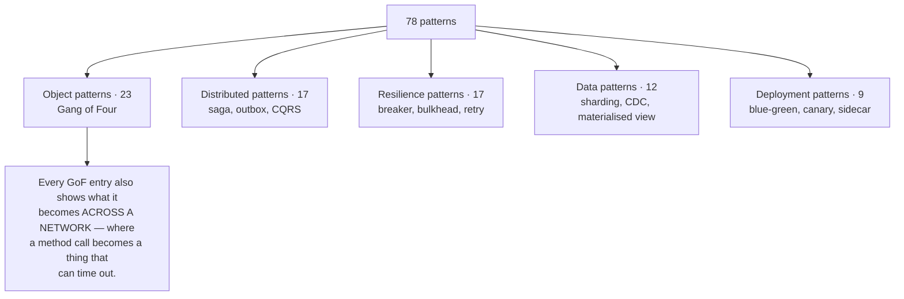

# Design Patterns

**→ [The full catalogue](CATALOGUE.md)** — 78 patterns across five families.

Most system design material covers architectural patterns and drops the Gang of Four on the grounds
that they are "just object-oriented design". This repository keeps both, because the interesting
thing is the relationship between them:

> Nearly every GoF pattern has a distributed counterpart, and the counterpart is harder for the same
> reason every time — the single-process version quietly relies on shared memory and one clock, and
> the distributed version has neither.

Singleton in one process is a static field. Singleton across a cluster is leader election: consensus,
a lease, a fencing token, and two nodes that can both believe they hold it during a partition. Same
intent, different universe.

| Family | Count | Level | Depth |
|---|---|---|---|
| Gang of Four | 23 | Objects and classes | Full entries |
| Enterprise integration | 17 | Messages between services | Indexed |
| Distributed systems | 17 | Nodes and data | Indexed |
| Resilience | 12 | Behaviour under failure | Indexed |
| Deployment | 9 | Change without downtime | Indexed |

Each Gang of Four entry carries **what · where · how · why · advantages · disadvantages ·
trade-off**, plus two fields a normal reference will not give you: the distributed counterpart, and
what an experienced engineer does differently.

`CATALOGUE.md` is generated by [`scripts/gen_pattern_catalogue.py`](../scripts/gen_pattern_catalogue.py)
from [`scripts/patterns_data.py`](../scripts/patterns_data.py); CI fails if the committed file drifts
from the data. Edit the data, not the markdown.

## Patterns with their own page

Some patterns are load-bearing enough that an index entry does not do them justice — they get the full
treatment, with failure modes and exercises.

| Pattern | The one thing to take away |
|---|---|
| [API gateway](api-gateway/) | One door for auth, routing, quotas and TLS. **It becomes a deployment bottleneck the moment domain logic leaks into it**, and that happens one reasonable request at a time. |
| [Factory Method](factory-method/) | Four different things get called "factory" and the Gang of Four one is the least used. The one people *do* write is a registry — and **a plugin registers on import, nothing imports it, so the lookup raises in production while passing CI**. |
| [Abstract Factory](abstract-factory/) | Its product is a *negative* guarantee — a mismatched family becomes unreachable. **Adding a family costs O(1), adding a product costs O(F)**, which is the whole decision. And it leaks the moment providers differ in capability rather than naming, which is why JDBC works and multi-cloud does not. |
| [Builder](builder/) | Two patterns share the name and the GoF one is not the one you have met. **Validation belongs in `build()`** — a setter cannot see a field that has not been set, so a cross-field rule is unreachable there. And `frozen=True` freezes the bindings, not the objects behind them. |
| [Prototype](prototype/) | Copying state is easy; the pattern is deciding what the copy must **not** inherit — identity, connections, locks, caches. The dangerous clone is **the one that does not raise**, and a golden image carrying the original host's SSH key is the same bug at fleet scale. |
| [Singleton](singleton/) | Everyone teaches thread-safe *creation*. The two that cost money are that **a correctly-created instance is not safe to use**, and that **"one" means one per process** — four workers hold four, a limiter set to 100 admits 400, and nothing anywhere reports it. |

## Related

- [Component combination matrix](../14-component-combinations/MATRIX.md)
- [System Design Thinking](../SYSTEM-DESIGN-THINKING.md) — the chain that forces these
- [Coverage gaps](../GAPS.md)
