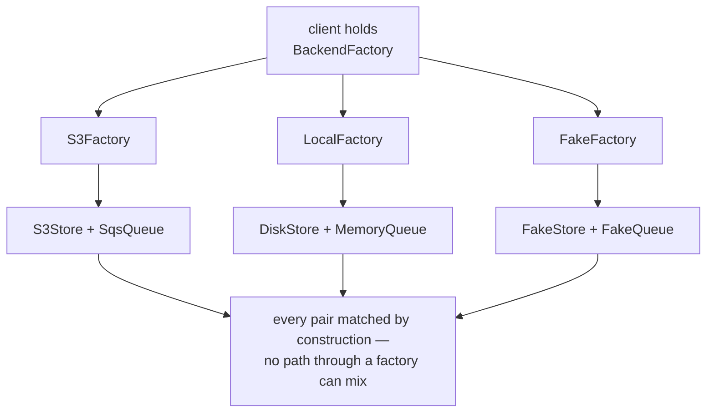

# Abstract Factory

`[INTERMEDIATE]` · An object with several creation methods, where each implementation returns a
**matched family**. Its product is not easier creation — it is a *negative* guarantee: an illegal
combination becomes impossible to express.

Two things on this page are worth more than the pattern itself. **The decision rule** — adding a
family is O(1), adding a product is O(F), so use it only where families grow and products do not.
And **why provider abstraction leaks** — families differ in capability, not naming, which is why
JDBC works and multi-cloud does not.

Every claim is asserted by a test in
**[`18-implementations/abstract-factory/`](../../18-implementations/abstract-factory/)**.

---

## 1. One-line definition

An interface with several creation methods, implemented once per family, so that every object a
caller receives is guaranteed to be compatible with every other object it received from the same
place.

## 2. Explain like I'm new

Some objects only work with each other. A Windows button belongs beside a Windows checkbox; pair it
with a Mac checkbox and the window looks broken, or crashes.

You *could* ask every part of the code to remember the rule. Abstract Factory removes the need to
remember by making the mistake unavailable:

```java
void render(GuiFactory f) {
    f.createButton().paint();
    f.createCheckbox().paint();
}
```

There is no expression inside `render` that produces a mismatched pair. Not discouraged —
unrepresentable. The client holds one factory, and that factory is the only source of either object.

**The test for whether you need this pattern:** is there an invariant across *two or more* objects?
If not, you want [Factory Method](../factory-method/) or a parameter. "I create several kinds of
thing" is not a reason — they have to be *required to match*.

## 3. Real-world analogy

A plug and a socket. Also the voltage, the frequency, and the earthing convention.

A UK kit gives you a UK plug, 230V, 50Hz, three pins. A US kit gives you a US plug, 120V, 60Hz, two
flat pins. Each set is internally consistent and the sets are not interchangeable — a UK plug in a
US socket is not "mostly fine", it is a different system.

What the analogy also predicts is the pattern's failure. **The two families are not symmetric.** UK
plugs have a fuse in the plug; US plugs do not. A universal adapter that exposes only what both
support cannot express "fused", and one that exposes everything lies about half its products. That
asymmetry is §5, and it is where cloud abstraction dies.

## 4. Technical explanation

### Every word of the definition, decoded

| Term | What it means |
|---|---|
| **interface with several creation methods** | One object, many `create*` methods — against Factory Method's one |
| **concrete factory** | An implementation of that interface. One per family |
| **family** | The group of products required to go together: all Windows widgets, all S3 clients |
| **matched set** | Every product from one factory works with every other from that same factory |
| **product** | What a creation method returns. Two or more product *types* is the minimum for this pattern to mean anything |

### The distinction people fumble

```
Factory Method     ONE product      a subclass decides      inheritance
Abstract Factory   MANY products    one object decides      composition
                                    ↑ and they must match  ← the point
```

Two axes: **how many products**, and **inheritance against composition**. Say both. Most answers
gesture at "one is bigger than the other", which is not the distinction.



### What the guarantee is actually worth in Python

Weaker than the textbook implies, and worth saying. Python has no package-private constructor, so
nothing stops someone writing `S3Store(), MemoryQueue()` by hand. What the pattern buys is that **no
path through the factory can mix families.** In Java, with package-private product constructors, a
mixed pair really is unrepresentable; in Python it is merely unreachable by anyone using the
intended door.

## 5. Engineering at scale

### 5a. The asymmetry — the decision rule nobody states

Everyone says Abstract Factory is "rigid". That is too vague to act on. The rigidity has a precise
shape, and it points at exactly one rule.

```
                   add a FAMILY              add a PRODUCT
                   (a new provider)          (a new kind of object)
                   ──────────────────        ──────────────────────
edits              1 new class               1 interface method
                   0 existing files          + 1 method in EVERY factory

cost               O(1)                      O(F)
```

> **Use Abstract Factory when the number of *families* grows and the number of *products* is
> stable.** Invert that and you have chosen the pattern that charges you on exactly the axis you are
> growing: every sprint is a mechanical edit across every factory, and each one is a place to make a
> mistake.

With 3 providers and 2 products, adding a product is 4 edits and nobody minds. With 5 providers and
8 products it is 6 edits of boilerplate for every new object type, forever, and the pattern has
become the obstacle.

### 5b. Where the ABC earns its keep

This contradicts the advice on the previous two pages, deliberately. For
[Singleton](../singleton/) and [Factory Method](../factory-method/), the Python answer was to skip
the hierarchy. Here the abstract base does real work:

```
TypeError: Can't instantiate abstract class LocalFactory with abstract method cache
```

**Add a product and every concrete factory fails loudly, at instantiation.** That is not an
annoyance — it is §5a's cost arriving at the exact moment you incur it, in your editor, rather than
at a call site in production. Duck-typed, the same change surfaces as an `AttributeError` on
whichever code path a user reaches first.

### 5c. The family that leaks — why provider abstraction fails

```
                         S3    GCS   Azure  Local disk
presigned URL            ✓     ✓     ✓      ✗
object versioning        ✓     ✓     ✓      ✗
storage classes          ✓     ✓     ~      ✗
object lock / legal hold ✓     ~     ✓      ✗
─────────────────────────────────────────────────────────
an honest common interface = the intersection = almost nothing
```

**Providers differ in *capability*, not only in naming.** That single fact defeats most attempts at
a provider abstraction, and no amount of interface design fixes it. There are four responses; the
first three are the ones people actually pick, and all three are bad.

| Option | What you get |
|---|---|
| **Union** — `presign` on the base, local raises `NotImplementedError` | **The type says you may call it; the runtime disagrees.** The worst option, and the most commonly chosen, because it is the one that compiles. Every caller now has to know which providers really implement it — which is exactly the knowledge the abstraction existed to remove |
| **Intersection** — drop `presign` entirely | Three of four providers lose a feature they have. Nothing raises and nothing lies, which is why this looks responsible. The cost is silent: you are paying for an abstraction that makes *every* option worse than picking one |
| **`isinstance`** — `if isinstance(store, S3Store)` | The abstraction is dead and still being maintained. Every new provider needs another branch, in every function that does this |
| **Declare capabilities** — `supports("presign")` | The asymmetry becomes a documented, checkable value. Not in the Gang of Four description, and the only honest one |

```python
class BackendFactory(ABC):
    capabilities: frozenset[str] = frozenset()

    def supports(self, capability: str) -> bool:
        return capability in self.capabilities

# S3Factory.capabilities    = {"presign", "versioning"}
# LocalFactory.capabilities = frozenset()        ← and it has no presign method at all
```

The fourth option does not pretend the family is symmetric. A caller branches on a value rather than
on a concrete type, and a provider that lacks a feature simply **does not have the method**, rather
than having it and raising. This is where mature libraries land.

<details>
<summary><strong>Why does JDBC work and multi-cloud not?</strong></summary>

**Symmetry by specification.** A standards body defined `Connection`, `Statement` and `ResultSet`
and required every driver to implement them. Drivers compete on performance and licensing, not on
having a different idea of what a result set is.

Cloud providers had no such constraint and competed precisely on **differentiation** — the features
that are not in the intersection are the reason you picked one. Abstracting them away discards the
thing you were paying for.

So the honest rule: abstract a family when something *forces* it to be symmetric — a specification,
or the fact that you wrote both sides. Otherwise accept lock-in.
</details>

> **The arithmetic nobody does:** the abstraction tax is paid **every day**, by every engineer, on
> every feature. The migration it protects against happens **once, or never**. A provider
> abstraction has to be very cheap to come out ahead, and the ones that leak are not cheap.

## 6. The problem it solves

A set of objects that are only correct together, where the right set depends on something chosen
once — platform, provider, environment — and where every part of the code would otherwise have to
remember the rule.

## 7. The problem it does NOT solve

- **Asymmetric families.** §5c. If the providers differ in capability, this pattern hides the
  difference rather than handling it.
- **One product.** That is Factory Method, and this is strictly more machinery for the same job.
- **Choosing which factory.** That is its own factory problem — a config string into a registry,
  which brings [Factory Method's registration bug](../factory-method/) along with it.
- **Enforcing the family across a process boundary.** §19.
- **Adding products cheaply.** §5a. It is explicitly bad at this.

## 9. How it works

### 9a. Java

```java
interface BackendFactory {
    Store store();
    Queue queue();
}

final class S3Factory implements BackendFactory {
    public Store store() { return new S3Store(); }
    public Queue queue() { return new SqsQueue(); }
}

final class LocalFactory implements BackendFactory {
    public Store store() { return new DiskStore(); }
    public Queue queue() { return new MemoryQueue(); }
}

void upload(BackendFactory f, String key, byte[] data) {   // names no concrete class
    f.store().put(key, data);
    f.queue().push(key);
}
```

### 9b. Python, the classic form

```python
class BackendFactory(ABC):
    family: str
    capabilities: frozenset[str] = frozenset()

    @abstractmethod
    def store(self) -> Store: ...

    @abstractmethod
    def queue(self) -> Queue: ...

    def supports(self, capability: str) -> bool:
        return capability in self.capabilities
```

Keep the ABC here — §5b. It is the one creational pattern in this catalogue where the hierarchy pays
for itself in Python.

### 9c. What you would actually write

```python
@dataclass(frozen=True)
class Backend:
    family: str
    store: Callable[[], Store]
    queue: Callable[[], Queue]
    capabilities: frozenset[str] = frozenset()

BACKENDS = {
    "s3":    Backend("s3",    S3Store,   SqsQueue, frozenset({"presign", "versioning"})),
    "local": Backend("local", DiskStore, MemoryQueue),
    "fake":  Backend("fake",  FakeStore, FakeQueue, frozenset({"presign"})),
}
```

**One class in total**, instead of one per family, and the invariant survives: both fields are
required so half a family will not construct, and `frozen=True` stops anyone swapping a member out
later.

Three things this buys that the hierarchy does not:

1. **Families are values.** Put them in a dict, pass them as arguments, sweep a test over every one
   without naming any.
2. **Adding a family is a line**, not a file.
3. **Configuration maps onto it directly** — `BACKENDS[cfg.provider]` and you are done.

What it gives up is §5b's loud failure: a third product breaks the `Backend(...)` call sites rather
than every factory at instantiation. Nearly as loud, considerably less ceremony — so the choice
between 9b and 9c comes down to how much you want the compiler shouting when the product set grows.

### 9d. The Java equivalent, since 8

```java
record Backend(String family, Supplier<Store> store, Supplier<Queue> queue) { }

static final Backend S3 = new Backend("s3", S3Store::new, SqsQueue::new);
```

Same collapse, same reasoning. The hierarchy was never about families; it was about languages where
a class could not be a value.

## 13. When to use it

| Use it when | Because |
|---|---|
| Two or more objects **must** match, and mixing is a real bug | That is the invariant the pattern sells |
| **Families grow, products are stable** | §5a. This is the decision rule |
| The family is symmetric **by specification** | JDBC, parser factories — a spec forced it |
| The family is symmetric **because you wrote both sides** | Test environments. See below |
| The choice is made **once**, at startup | A per-call choice wants a registry instead |

**The underrated one: your test environment.** The best Abstract Factory most people will ever write
hands out a matched fake clock, fake store and fake queue, so a test physically cannot reach a real
dependency while using a fake one. It is symmetric by construction — you control both
implementations — which is exactly the condition §5c says the pattern requires and cloud providers
do not meet.

## 14. When NOT to use it

- **Products grow faster than families.** §5a. Every new product is an edit in every factory.
- **The providers differ in capability.** §5c. You will pick one of three bad options.
- **One product type.** Factory Method, or a parameter.
- **"Multi-cloud" as a goal in itself.** Pay the tax daily for a migration that happens once, or
  never.
- **You want to choose per call.** The factory is chosen once; you want a registry.

## 17. Trade-offs

| Axis | What you gain | What you give up |
|---|---|---|
| Correctness | Mixed families become unreachable through the factory | Nothing. This part is the pattern working |
| Swapping families | One line — the whole set changes together | — |
| Adding products | — | Every factory changes. O(F), forever |
| Honesty | — | Unless capabilities are declared, the interface claims a symmetry the family does not have |
| Capability | Uniform surface across providers | The intersection of what they all do, which may be worth less than one provider alone |

**The one sentence:** *family consistency bought with rigidity.*

## 18. Alternatives — the "why not?" table

| Instead of Abstract Factory | Why | When it is right |
|---|---|---|
| **Frozen dataclass / record of callables** | One class; families become values | Default in Python, and increasingly in Java |
| **Factory Method** | One product, by inheritance | There is no cross-object invariant |
| **DI container profiles / module bindings** | The container binds the whole family | Once wiring is big enough to be tedious — and the modern form of this pattern |
| **Pick one provider** | No abstraction, no tax, no leak | **Most of the time**, when the family is asymmetric |
| **Adapter per provider, no common factory** | Each provider keeps its full surface | When you genuinely need each provider's distinctive features |

## 19. Failure scenarios

| Architecture | What actually happens |
|---|---|
| **Monolith** | Works as designed. The compiler enforces the family |
| **Plugin / config-driven** | Choosing *which* factory is itself a factory problem — a config string into a registry, which drags in [Factory Method's registration bug](../factory-method/) |
| **Microservices** | **The invariant stops being enforceable.** In-process, one object made both products, so they match by construction. Across services, "EU storage *and* EU queue" is a line in a config file, not a type. A misconfigured deploy mixes families, nothing catches it, and you find out from a data-residency audit |
| **Serverless** | Factories are rebuilt per cold start, which is cheap. The real risk is config drift between functions — each one picks its own family, and nothing checks they agree |

### The distributed counterpart

**Provider abstraction · driver families.** Harder for two reasons stacked on each other: the
families differ in what they can *do* rather than only in what they are *called*, and the invariant
migrates out of the type system into a configuration file, where the only thing enforcing it is that
someone set two environment variables consistently.

A type error becomes a deployment convention. Nothing fails at build time, and the failure mode is
"it works, in the wrong region".

## 25. Without it → With it → New problem → Next

| Stage | State of the world |
|---|---|
| **Without it** | Every call site picks its own store and its own queue. One of them gets it wrong and writes to local disk while the worker reads from SQS. The bug is invisible until the data is missing |
| **With it** | One factory per family; a mismatched pair is unreachable through it. Swapping provider is one line |
| **New problem** | Adding a product type is now an edit in every factory (§5a), and the interface quietly asserts a symmetry the providers do not have (§5c) |
| **Next** | Declare capabilities instead of hiding them, and collapse the hierarchy to a frozen dataclass if the product set is stable |
| **And then** | Split into services and the invariant leaves the type system for a config file (§19). Now it needs a deploy-time check, not a compiler |

## 27. Implementation

**[`18-implementations/abstract-factory/`](../../18-implementations/abstract-factory/)** — runnable,
stdlib only.

```bash
pytest test_abstract_factory.py -q     # 15 tests
python abstract_factory.py             # the same assertions, no test runner
```

What is pinned there rather than claimed:

- the invariant, **swept over every factory** — because checking one proves the pattern was
  understood, while checking all of them catches the copy-pasted fourth factory, which is the
  realistic bug. Verified by making exactly that mistake
- a factory missing one method **will not instantiate** — §5a's cost, in a `TypeError`
- **all four options from §5c, runnable side by side**: the union raising at runtime after the type
  promised otherwise, the intersection silently costing everyone the feature, the `isinstance`
  branch, and capabilities
- the frozen dataclass keeping the invariant with one class — **half a family will not construct**

No `bench.py`. The expensive thing about this pattern is what it costs to *change*, which is counted
rather than timed.

## 28. Common mistakes

1. **Using it with one product type.** That is Factory Method with extra steps.
2. **Choosing it when products grow faster than families.** §5a — the one decision that matters.
3. **Putting a capability on the base that half the family cannot do.** The type now lies. §5c.
4. **`isinstance` checks against concrete factories.** The abstraction is dead; delete it or fix it.
5. **Abstracting cloud providers to "avoid lock-in".** Daily tax, one-time benefit, leaky result.
6. **Testing one factory.** The guarantee is only as strong as the least careful one.
7. **Forgetting that picking the factory is its own problem**, with its own registration bug.
8. **Assuming the family holds across services.** §19. It is a config convention there.
9. **Skipping the ABC in Python here.** The loud failure is the feature. §5b.
10. **Letting a factory be stateful.** It is a creation strategy; give it state and swapping families
    silently changes behaviour beyond which classes get built.

## 30. Testing

1. **Sweep every factory, not one.** `@pytest.mark.parametrize("factory", FACTORIES)`. A test
   written against a favourite factory cannot catch the next one someone adds.
2. **Assert the incomplete factory fails.** It documents the O(F) cost in executable form, and it
   fails the day someone adds a product and misses a family.
3. **Make all four leak options runnable.** The choice between them is the real decision in any
   provider abstraction, and three bullet points convince nobody.
4. **Use a `FakeFactory` as your test environment.** §13 — it is the best use of this pattern, and
   it makes "a test reached a real dependency" structurally impossible.

## 31. Exercises

**1. Count your axes.** For a provider abstraction in a codebase you know, count the families and
the products. Which one is growing? If it is products, §5a says you have the wrong pattern.

**2. Find the lie.** Find a method on a common interface that at least one implementation raises
`NotImplementedError` from. Replace it with a declared capability and count the `isinstance` checks
you can now delete.

**3. Collapse the hierarchy.** Take a two-product Abstract Factory and rewrite it as a frozen
dataclass. Count classes before and after, and name what you gave up.

**4. Break the invariant deliberately.** Make one factory return a mismatched product and confirm
your tests catch it. If only one test fails and it is the one for that factory, you were lucky —
check whether a *new* factory would be covered at all.

<details>
<summary><strong>Interview: the follow-ups that separate people</strong></summary>

The Factory Method comparison is the opener and it is covered on
[that page](../factory-method/). These are the ones that go deeper.

| Follow-up | What they want to hear |
|---|---|
| *"Add a new product to the family."* | **Every factory changes.** Then, unprompted: so use it when families grow and products do not |
| *"One provider doesn't support feature X."* | The four options in §5c — and that the real answer is often "do not abstract" |
| *"Why does JDBC work and multi-cloud not?"* | Symmetry by specification against competition on differentiation |
| *"How do you pick the factory?"* | Config → registry → and then the registration bug, volunteered |
| *"Do it in Python."* | A frozen dataclass of callables. And, unprompted, that the ABC is worth keeping here even though it is not for Singleton |
| *"Is the GoF UI example still relevant?"* | Honestly no — clearest teaching example, nobody ships widget sets this way now |
| *"Across services?"* | The invariant leaves the type system for a config file. Nothing fails at build time |

**What marks a senior answer:** treating the choice as an **asymmetry question** — which axis grows,
and are the families actually symmetric — rather than as a class diagram.
</details>

## 33. Related

- **[Implementation](../../18-implementations/abstract-factory/)** — the runnable version of every
  claim here
- [Factory Method](../factory-method/) — one product by inheritance; the pattern this is most
  confused with, and where "which factory do I pick" leads
- [Singleton](../singleton/) — the other creational pattern whose real cost is a boundary nobody
  names
- [Pattern catalogue](../CATALOGUE.md#abstract-factory) · [Design patterns](../)
- [Monolith vs microservices](../../02-architecture/monolith-vs-microservices/) — where the family
  invariant becomes a deployment convention
- [Trade-off framework](../../TRADEOFF-FRAMEWORK.md) — the axes §5a and §5c sit on
- [Glossary: idempotency](../../GLOSSARY.md#idempotency)
