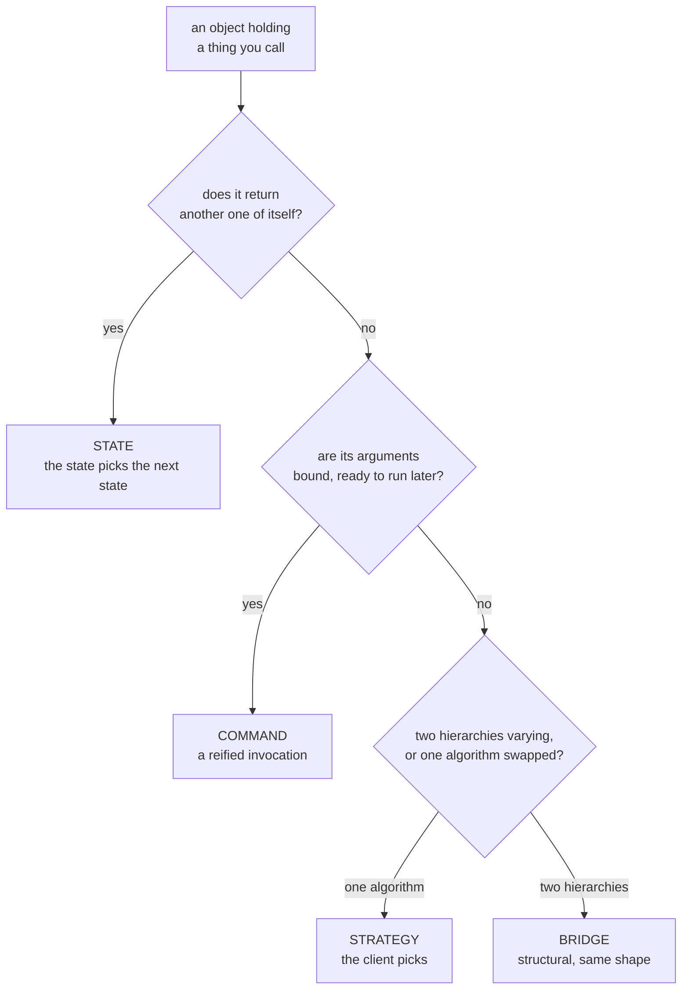

# Strategy, State, Command

`[INTERMEDIATE]` · Three behavioural patterns with one skeleton — and [Bridge](../structural/)
looks like it too:

```python
class Context:
    def __init__(self, thing): self._thing = thing
    def run(self, x):          return self._thing.execute(x)
```

**Four patterns, one shape, told apart by intent.** Same situation as
[the four wrappers](../wrappers/), so the same treatment: one page, because the distinction exists
in comparison and nowhere else.

Every claim is asserted by a test in
**[`18-implementations/behavioural/`](../../18-implementations/behavioural/)**.

---

## 1. Telling them apart



| | Who chooses | When | Distinguishing feature |
|---|---|---|---|
| **Strategy** | the **client**, from outside | construction, or swapped | no method returns another strategy |
| **State** | the **state itself** | every transition | **`on(event) -> State`** |
| **Command** | nobody — one is created per action | — | **arguments bound**; can be stored |
| **Bridge** | whoever wired it | construction | two hierarchies, not one algorithm |

### Strategy against State — the pair people get wrong

The usual answer, *"a strategy is an algorithm and a state is a state"*, restates the names. The
property that separates them is visible on the class:

> **A strategy has no method returning another strategy — the *client* picks one.
> A state has `on(event) -> State` — the *state* picks the next one.**

```python
assert not hasattr(StandardShipping(), "on")     # no strategy picks a successor
assert Pending().on("pay").name == "paid"        # the state did, unprompted
```

That absence is why comparing options has to live **outside** the strategies — no strategy knows
the others exist. And the presence is the whole reason State exists: the transition table is
distributed across the states, each owning its own exits, instead of a nest of if-else at every
call site.

### Command is the odd one out, and the most useful

Strategy is *how* to do something. **A command is a specific invocation, reified** — arguments
bound, nothing run yet. A strategy cannot be put on a queue because it has no arguments; a command
can, and **once it can be queued it is a message**. That single change is what makes this the
behavioural pattern that reaches furthest into distributed systems. §4.

## 2. State — and why the missing arrows are the specification

```python
TRANSITIONS = {
    "pending":   {"pay": "paid", "cancel": "cancelled"},
    "paid":      {"ship": "shipped", "refund": "refunded"},
    "shipped":   {"deliver": "delivered"},
    "delivered": {}, "cancelled": {}, "refunded": {},
}
```

The catalogue's note is the one to carry: **draw the diagram first and treat the missing arrows as
the specification.** The value is not in the transitions you implemented, it is in the ones you
made unrepresentable. `shipped → pending` should not be a bug you fix later; it should be an
expression that cannot be written.

Which means the test has to be a **sweep**, not samples:

```python
@pytest.mark.parametrize("state_name", sorted(STATES))
@pytest.mark.parametrize("event", EVENTS)
def test_every_state_event_pair_matches_the_table(...):
```

All 15 combinations, generated rather than chosen. "Illegal transitions are impossible" means
nothing if you checked the two you thought of.

### When a table beats the classes

The dict above is kept deliberately, because **if only the transitions differed, the dict would be
the better implementation** and six classes would be ceremony. What earns the classes is behaviour
that differs per state:

```python
Pending().cancel()   # "cancelled, nothing to refund"
Paid().cancel()      # "cancelled, refund issued"
Shipped().cancel()   # IllegalTransition — it is in a van
```

A table cannot express that without a second table of behaviours, at which point it is a worse
class. **Transitions only → table. Behaviour too → classes.** That is the decision, and most
write-ups skip it.

### Distributed: there is no atomic transition

```python
order.transition("pay",  expected="pending")   # worker A wins
order.transition("ship", expected="pending")   # worker B had a stale read → raises
```

In one process, `self.state = self.state.on(event)` is fine. Across services it is a **lost
update**: both workers read `paid`, both decide to ship, both write `shipped`. Two shipments, one
order, and **no error anywhere**.

The fix is not a lock. It is the conditional update every database already offers:

```sql
UPDATE orders SET state = 'shipped' WHERE id = ? AND state = 'paid'
```

**Zero rows affected means you lost.** Which is why the return value of an `UPDATE` is worth
checking, and why a transition that cannot report losing is not safe to run twice.

The catalogue adds the half this cannot show: transitions must be **durable and exactly-once**,
because a crash *mid-transition* leaves the machine in a state that does not appear on the diagram
at all. That is what workflow engines — Step Functions, Temporal — exist to provide, and it is why
"we'll just keep a status column" stops working as soon as a transition has side effects.

## 3. Strategy — and the thing to do instead

```python
cheapest(25, [StandardShipping(), ExpressShipping(), FreeOverThreshold()])
```

The catalogue's advice is sharp and worth repeating: **make the default correct and the choice
rare, rather than exposing a menu.** A strategy parameter is a question asked of every caller, and
most callers do not have the information to answer it.

The load-balancing example makes the point: least-connections usually beats round-robin for
heterogeneous request costs, **and the right choice depends on live conditions the caller cannot
observe** — which is an argument for choosing *adaptively* rather than for a config flag.

### In Python it is usually a function

```python
assert StandardShipping().cost(kg) == standard_fn(kg)
```

`sorted(key=...)` is Strategy and nobody writes a class for it. **A class with one method and no
state is a function with ceremony** — the same finding as [Factory Method](../factory-method/) and
[Builder](../builder/), from a third direction. Keep the class when the strategy has state of its
own, like a threshold.

## 4. Command — the bridge to everything distributed

### Undo is compensation, not deletion

```python
inv.run(ChargeCard(40.0))
inv.undo_last()

inv.ledger    # ["charge 40.00", "refund 40.00"]  — two entries, not zero
```

**You cannot un-charge a card.** A refund is a new, separate movement of money, with its own fee
and its own settlement time, visible to both parties. The ledger grows; it never shrinks.

Modelling undo as "remove the row" is how a system ends up unable to explain itself to an auditor —
and it is precisely why the distributed version of this pattern is
**[Saga](../CATALOGUE.md#distributed-systems-patterns)**, which compensates rather than rolls back.

Some commands have no meaningful undo at all. A correction email is not an undo; the first one was
read. **Part of designing a saga is noticing which steps can never be taken back, and ordering them
last.**

### Undo runs in reverse, and that is not a detail

Steps depend on each other. Releasing stock before refunding the card that paid for it leaves a
window where the customer has neither the goods nor the money.

### A retried command double-charges

```python
ChargeCard(99.0).execute(ledger)                       # delivered
ChargeCard(99.0).execute(ledger)                       # redelivered
# ["charge 99.00", "charge 99.00"]
```

The first thing anyone discovers after putting commands on a queue: **a queue that guarantees
delivery guarantees *at least once*.** The redelivery is not an edge case, it is scheduled. An
[idempotency key](../../07-api-design/idempotency/) makes it a no-op — at-least-once delivery,
exactly-once effect.

### The log is the product

Same list, four names:

| Where it lives | What it is called |
|---|---|
| In memory, for the current session | an **undo stack** |
| On disk, before the state change | a **write-ahead log** |
| Shipped to another node | a **replication stream** |
| Kept forever *instead of* the state | **event sourcing** |

A log that cannot be replayed is a history, not a recovery mechanism, and the difference only shows
up when you need it.

### The discipline that makes it survivable

The catalogue's note on Command is the most important sentence on this page:

> **A serialised command is a permanent public API.** One written today may be replayed in two
> years by code that does not exist yet.

So it is versioned from day one, and a field's meaning is never quietly changed. Renaming a field
in a class is a refactor; renaming it in a command that is already in a log is **rewriting
history that something will read back**. That discipline is the difference between event sourcing
working and event sourcing becoming the thing the team is afraid of.

## 5. Interview

| Question | What they want |
|---|---|
| *"Strategy or State?"* | **A state returns the next state; a strategy does not.** The client picks a strategy; a state picks itself. Saying "they are the same shape" first is the signal |
| *"Why is State better than an if-else?"* | The illegal transitions become **unrepresentable**, not merely unhandled. Then: the missing arrows are the specification |
| *"When would a dict beat it?"* | When only transitions differ. Classes earn their place when **behaviour** differs per state |
| *"Two workers both read `paid`."* | Compare-and-swap on the state column, and check the affected row count. Not a lock |
| *"What's a Command for?"* | It is an invocation with its arguments bound, so it can be queued, logged, replayed and undone. **Then it is a message** |
| *"Implement undo."* | Compensation, not inverse. The log grows. Some steps have no undo, and those go last |
| *"You put it on a queue."* | At-least-once delivery. Idempotency key, or it charges twice |
| *"Event sourcing?"* | Store the commands instead of the state — and a serialised command is a permanent public API |

**What marks a senior answer:** treating all three as the same shape and reaching for an
**observable property** — does it return its own type, are its arguments bound — rather than
describing purpose.

## 6. Implementation

**[`18-implementations/behavioural/`](../../18-implementations/behavioural/)** — runnable, stdlib
only.

```bash
pytest test_behavioural.py -q     # 30 tests
python behavioural.py             # the same assertions, no test runner
```

Every test is a **discriminator** — true of one pattern, false of another. Three tests each showing
a pattern working would prove nothing about the only question that matters.

Pinned there: no strategy has an `on`, every state does; all 15 state/event pairs swept against the
table so the classes and the dict cannot drift; `cancel` differing per state; a stale writer losing
the compare-and-swap; the ledger *growing* on undo; undo unwinding in reverse; a retried charge
hitting twice without a key and once with one; and the log replaying into a fresh ledger.

Then **seven deliberate breaks**, all caught — including making `Shipped` accept `pay`, which fails
the sweep at exactly `[pay-shipped]`, and making a strategy return a successor, which fails **both**
headline tests at once, because at that point it is a state.

## 7. Related

- **[Implementation](../../18-implementations/behavioural/)** — the runnable version of every claim
- [Wrappers](../wrappers/) — the structural family's "one shape, four intents"
- [Bridge, Composite, Flyweight](../structural/) — Bridge is this shape again
- [Idempotency](../../07-api-design/idempotency/) — the key that makes §4's retry safe
- [Circuit breaker](../../08-reliability/circuit-breaker/) — a state machine with exactly §2's
  problem, in production
- [Retries](../../08-reliability/retries/) — where at-least-once delivery comes from
- [Pattern catalogue](../CATALOGUE.md#strategy) — and
  [Saga](../CATALOGUE.md#distributed-systems-patterns), Command's distributed counterpart
- [Types of system design](../../SYSTEM-DESIGN-TYPES.md) — why the low-level layer is kept here
