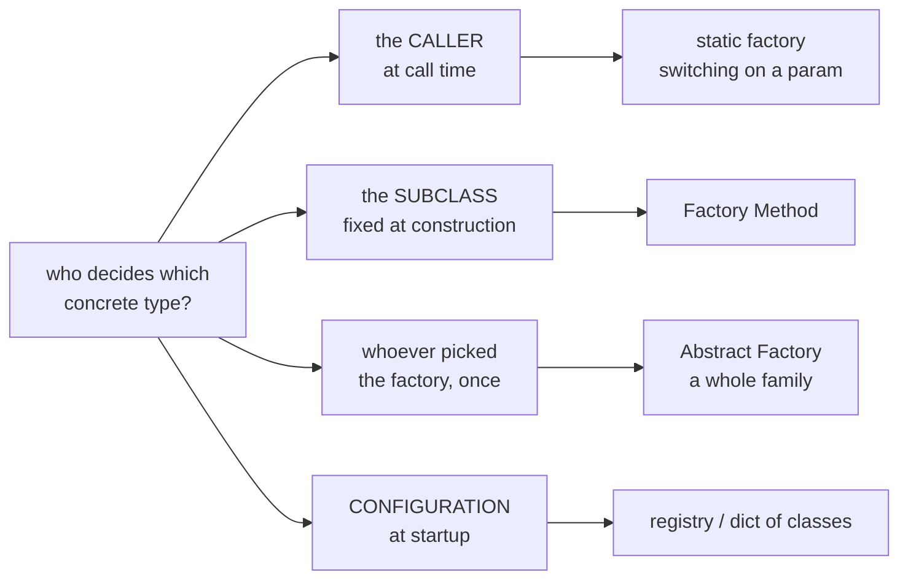
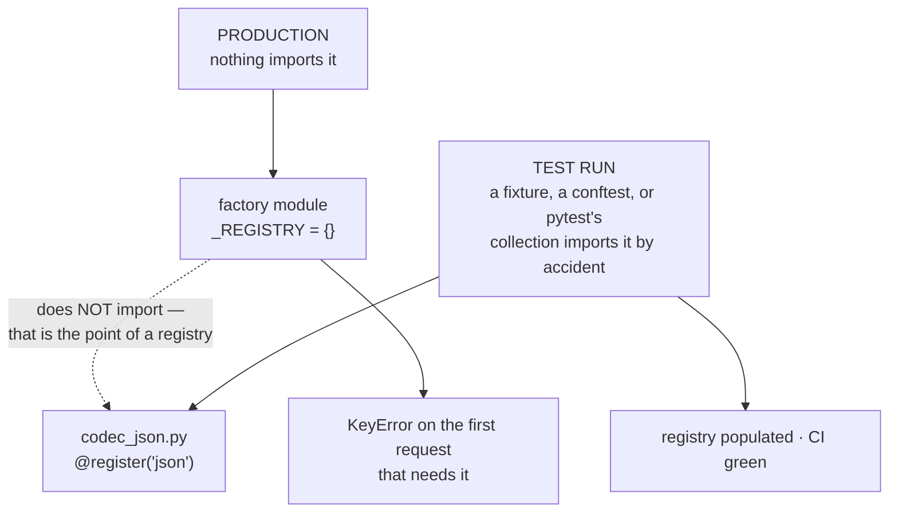

# Factory Method

`[INTERMEDIATE]` · A method the base class *calls* but does not *implement*, so a subclass decides
which object the algorithm works with.

**An honest framing first.** Factory Method proper is a small pattern, and you will use it less than
almost anything else in the catalogue. Most of this page is about something more useful: **four
different things get called "factory", the Gang of Four one is the least common, and the one people
actually write — a registry — carries a production bug that CI structurally cannot see.**

Every claim here is asserted by a test in
**[`18-implementations/factory-method/`](../../18-implementations/factory-method/)**.

---

## 1. One-line definition

A creation method declared in a base class and overridden by subclasses, so the base class's
algorithm can build objects whose concrete type it never names.

## 2. Explain like I'm new

A class needs to make something, but it does not know *what kind*.

```java
abstract class Dialog {
    abstract Button createButton();        // declared here, implemented NOWHERE here

    void render() {                        // ← the algorithm lives in the base class
        Button b = createButton();         // ← and it calls DOWN into the subclass
        b.onClick(this::close);
        draw(b);
    }
}
```

`render()` is written once and never changes. `createButton()` is the single hole subclasses fill.
`WindowsDialog` fills it with a Windows button, `WebDialog` with an HTML one, and `render()` is
untouched by either.

**That inversion is the whole pattern:** the base class owns *what happens*, the subclass owns
*which objects it happens to*.

## 3. Real-world analogy

A recipe says *"sear the protein, then rest it for five minutes."* It does not say chicken.

The recipe is the base class and it is complete — timings, order, technique, all fixed. "Which
protein" is the one decision it delegates, and a cook who picks lamb has not rewritten the recipe,
only answered its one open question.

What the analogy also explains is the cost. **You now need a separate recipe card per protein**, and
each one differs by a single line. With two proteins that is obvious overhead; the fix is a recipe
that takes the protein as an *ingredient* rather than spawning a variant per choice. In code that is
§9d, and in most modern languages it is the right answer.

## 4. Technical explanation

### Every word of the definition, decoded

| Term | What it means |
|---|---|
| **creation method** | An ordinary method whose only job is to return a new object |
| **base class** | The class holding the *algorithm* that needs that object |
| **override** | A subclass replaces the method's body |
| **"their own type"** | Each subclass returns a different concrete class |
| **creator** | GoF's name for the base class — the one that calls the factory method |
| **product** | GoF's name for what the factory method returns |

The sentence everyone quotes — *"define a creation method in a base class; subclasses override it to
return their own type"* — leaves out the part that makes it a pattern: **the base class calls a
method it does not implement.** Without that call, you just have a method that makes things.

### It is Template Method, applied to creation

Structurally identical: a fixed algorithm in the base class with one abstract hole for subclasses.
Worth knowing, because it explains why a pattern filed under *Creational* looks exactly like a
*Behavioural* one — the only difference is that the hole returns an object instead of performing a
step.

### The four things called "factory"

This is the section that matters. When someone says *"I'll add a factory"*, they mean one of these,
and usually not the Gang of Four one.

| What people say | What it actually is | GoF? |
|---|---|---|
| "a factory" *(most common)* | a static method that switches on a parameter | **No** |
| **Factory Method** | an overridable method — the **subclass** decides | Yes |
| **Abstract Factory** | an object with *several* creation methods returning a matched family | Yes |
| **static factory method** | a named constructor — `Integer.valueOf`, `datetime.fromisoformat` | No — *Effective Java* Item 1 |
| factory function | any function that returns an object | Not a pattern |

The axis that separates them is one question: **who decides, and when?**



"Which one do I want?" is really **"who should be allowed to decide, and when?"**

## 5. Engineering at scale

### The registry that nobody populated

The "factory" most people actually write is a dict, and it carries a bug that **passes CI by
construction**:

```python
_REGISTRY = {}

def register(name):
    def deco(cls):
        _REGISTRY[name] = cls      # runs ONLY when this module is imported
        return cls
    return deco

def codec(name):
    return _REGISTRY[name]()       # KeyError if nothing imported the plugin
```

```python
# codec_json.py — correct, on disk, spelled right
@register("json")
class JsonCodec: ...
```

**`register("json")` is a line of code, and lines of code only run when their module is imported.**
The factory cannot import the plugins — that is precisely the coupling a registry exists to remove.
So:



In a test suite something *always* imports it by accident. In a service, nothing does.

> This is not hypothetical. It is the same shape as a model-kind registry where the kind string
> appeared exactly once in the codebase — and deleting the module that defined it would have left
> the registry logging "unavailable" forever, because a `registry.py` import was the only thing
> making the kind resolve at all.

Three ways out, each with a real cost:

| Fix | What it costs |
|---|---|
| **Explicit imports in the factory module** | Reintroduces the coupling you removed. The factory now imports the world: slow startup and circular imports |
| **Entry points / `ServiceLoader`** | Decoupled and declarative — but registration moves into *packaging metadata*, so a missing `pip install -e .` silently empties the registry |
| **Eager validation at startup** | Keep lazy imports, and at boot assert every configured key resolves. **This is the answer, and almost nobody writes it** |

### Fail at boot, or fail at 3am

A factory that takes a string is a **trust boundary** — the string arrived from a config file or an
HTTP header. Three lines decide which failure shape you get:

```python
def validate_configured(names):
    missing = [n for n in names if n not in _REGISTRY]
    if missing:
        raise UnknownCodec(f"configured but not registered: {missing}; known: {sorted(_REGISTRY)}")
```

Identical configuration, one flag, measured by two adjacent tests:

| | without validation | with validation |
|---|---|---|
| `start()` | succeeds | **raises, naming `csv`** |
| first request | succeeds | never happens |
| the request that needs `csv` | **raises** | never happens |
| requests served when it broke | **2** | **0** |

Without it there is no failure at deploy, none in the smoke test, and none on any endpoint anybody
checked. The deploy is declared good and the process is hours old before one user finds the code
path that needed the missing codec. **The typo was in `config.yaml` the whole time.** Listing what
*is* registered in the error is the difference between a thirty-second fix and a thirty-minute one.

<details>
<summary><strong>What is a trust boundary?</strong></summary>

The line where data stops being yours and starts being someone else's — a request body, a header, a
config file, an environment variable, another team's API response.

Everything crossing it is **unvalidated input**, regardless of how it is spelled in your code. A
`str` that came from `config.yaml` has the same trustworthiness as one from a query string: both can
be wrong, and the compiler believes both.

Factories sit on this line more often than people notice, because the whole purpose of a string key
is to let something outside the code choose. That makes "unknown key" an *input validation* outcome
— a 400, not a 500 — which is why the implementation raises a distinct `UnknownCodec` rather than a
bare `KeyError`.
</details>

### The import cycle

The factory must know every concrete class; every concrete class usually needs something from the
core:

```
core  →  factory  →  concrete  →  core
```

Python says `ImportError: cannot import name X (most likely due to a circular import)`. The usual
"fix" is moving the import inside the function, which does not remove the cycle — it relocates the
failure from startup to runtime, where it is strictly worse.

### The same bug in a second costume

A module imported under two names has **two of every registry**. Run a file as a script and it is
`__main__`; a plugin's `from factory_method import register` then imports a *second copy*, the
decorator writes into one and the lookup reads the other. The usual production sighting is a package
imported once as `pkg.mod` and once as `mod`.

Same sentence every time: **the registry you are reading is not the registry that was written.**

## 6. The problem it solves

A class that must create objects, in a place where naming the concrete class would be wrong —
because the right class depends on something the base class cannot know: which platform, which
subclass, which plugin shipped.

## 7. The problem it does NOT solve

- **Runtime dispatch.** The subclass answered once, at construction. People who wanted "decide per
  call" reach for this and get inheritance instead; they wanted a registry or a parameter. §9f.
- **Third-party extension.** A subclass of *your* class still has to exist in *someone's* source and
  be instantiated by someone who knows about it. Letting strangers add implementations needs a
  service-provider framework — `entry_points()`, `ServiceLoader` — not this.
- **Knowing the plugin was registered.** §5.
- **Two products that must match.** That is Abstract Factory. §18.

## 9. How it works

### 9a. The Gang of Four form, in Java

```java
abstract class Exporter {
    protected abstract Formatter createFormatter();   // THE factory method

    public final byte[] export(Report r) {            // `final` — see 9b
        Formatter f = createFormatter();
        return concat(f.header(), f.rows(r.rows()), f.footer());
    }
}

final class CsvExporter extends Exporter {
    protected Formatter createFormatter() { return new CsvFormatter(); }
}

final class PdfExporter extends Exporter {
    protected Formatter createFormatter() { return new PdfFormatter(); }
}
```

### 9b. Why `export` is `final`

The detail most write-ups skip. If subclasses may override the **algorithm** as well as the
**product**, the guarantee the pattern exists to provide is gone: *"one algorithm, many products"*
becomes *"anything, anything"*, and the base class no longer promises anything a caller can rely on.

Mark the algorithm `final` and leave exactly one hole. In Python there is no `final`, so this is a
convention the name carries — `_create_formatter` is private, `export` is not.

### 9c. The same thing in Python — and why it is the wrong answer

```python
class Exporter(ABC):
    @abstractmethod
    def _create_formatter(self) -> Formatter: ...

    def export(self, rows):
        f = self._create_formatter()
        return "\n".join(f.row(r) for r in rows)

class CsvExporter(Exporter):
    def _create_formatter(self): return CsvFormatter()     # two extra classes
```

It works. It costs two classes to express *"use CsvFormatter"*.

### 9d. What you would actually ship

```python
class Exporter:
    def __init__(self, make_formatter=CsvFormatter):       # the class IS the argument
        self._make = make_formatter

    def export(self, rows):
        f = self._make()
        return "\n".join(f.row(r) for r in rows)

Exporter(PdfFormatter)          # no subclass, no hierarchy, no pattern
```

**In Python a class is an ordinary value** — storable in a dict, passable as an argument, callable.
`CsvFormatter` already *means* "make me one of these", so wrapping it in a class that returns it is
a layer with no content. Measured in the implementation: identical output,
`Exporter.__subclasses__()` of length 2 against `[]`.

**Factory Method is largely a workaround for languages where classes are not values.** And since
Java 8, Java is no longer one of them:

```java
class Exporter {
    private final Supplier<Formatter> make;
    Exporter(Supplier<Formatter> make) { this.make = make; }
}

new Exporter(CsvFormatter::new);     // two classes collapse into one argument
```

The GoF form is still correct. It is rarely the shortest correct thing in either language now.

### 9e. The static factory method — not this pattern, but the one you will use daily

```java
Integer.valueOf(42)          // caches −128…127 — a constructor cannot return a cached instance
List.of(1, 2, 3)             // returns a private immutable subtype
BigInteger.probablePrime(…)  // has a NAME; `new BigInteger(int, int, Random)` does not
```

```python
datetime.fromisoformat("2026-10-12")    # a named constructor
dict.fromkeys(["a", "b"], 0)
logging.getLogger("app.db")             # also a registry: same name, same object
```

*Effective Java* Item 1. Four things a constructor cannot do: **have a name**, **return a cached
instance**, **return a subtype**, and **exist before the class it returns does**. None of that is
Factory Method — no subclass decides anything — and all of it is more useful more often.

### 9f. The axis that catches people: *when* the decision happens

```
registry        asked on every call  →  can answer differently each time
Factory Method  answered once, at construction  →  cannot change its mind
```

That immutability is a feature when you want the guarantee, and a disappointment when you wanted
runtime dispatch. `test_the_subclass_decides_at_construction_not_at_call_time` pins it: the same
`CsvExporter` returns a `CsvFormatter` every time, forever.

## 13. When to use it

| Use it when | Because |
|---|---|
| A fixed algorithm needs a varying product, and the variation is **by subclass** | That is literally the pattern |
| You are writing a **framework extension point** | Subclassing is the extension mechanism users already expect |
| The product choice must be **fixed for an object's lifetime** | A registry would let it drift |
| You are implementing **iteration** | `__iter__` / `iterator()` is the canonical instance |

**And the top-1% rule from the catalogue: add it when the *second* variant appears, not in
anticipation of one.** A factory with a single implementation is speculative generality — the cost
is paid now, the benefit may never arrive.

## 14. When NOT to use it

- **One variant.** You have added a layer and bought nothing.
- **The language has first-class classes or lambdas.** §9d. Pass the thing.
- **You wanted dispatch on a runtime value.** You want a registry or a parameter.
- **You wanted third parties to add types.** You want entry points. §7.
- **You wanted a named constructor.** You want a static factory method. §9e.

## 17. Trade-offs

| Axis | What you gain | What you give up |
|---|---|---|
| Coupling | Callers depend on the interface, not a concrete constructor | The hierarchy itself is new coupling |
| Extension | A new product is a new subclass; no caller changes | A class per variant, forever |
| Guarantees | The algorithm is fixed; only the product varies | Only if the algorithm is `final` — §9b |
| Flexibility | — | The decision is frozen at construction. §9f |
| Readability | Intent is explicit in the type | Two files to read what one parameter would have said |

**The one sentence:** *flexibility bought with indirection.*

## 18. Alternatives — the "why not?" table

| Instead of Factory Method | Why | When it is right |
|---|---|---|
| **Pass the class / a `Supplier`** | One argument instead of a hierarchy | Default in Python; usually right in modern Java |
| **Static factory method** | A named constructor that may cache or return a subtype | Whenever the real need is "a constructor with a name" |
| **Registry / dict of classes** | Configuration picks, at runtime | Plugins, codecs, drivers — with §5's validation |
| **Entry points / `ServiceLoader`** | Third parties register without you knowing they exist | Genuinely open extension |
| **Abstract Factory** | A *family* of products that must match | Cross-platform toolkits, provider abstractions |
| **DI container** | The container decides and injects | Once wiring is big enough to be tedious |

### Factory Method vs Abstract Factory, in one line each

- **Factory Method** — **one** product, chosen by **inheritance**. A subclass overrides one method.
- **Abstract Factory** — **a family** of products, chosen by **composition**. You hold a factory
  object with several methods; its implementations return a matched set.

Two axes: *how many products*, and *inheritance vs composition*. That is the whole distinction, and
it is the most-fumbled Gang of Four question there is.

## 19. Failure scenarios

| Architecture | What actually happens |
|---|---|
| **Monolith** | Works as described. A function call that returns or raises, now, synchronously |
| **Plugin / extensible app** | §5 dominates. The pattern is fine; the *registration* is the system, and it is where the bug lives |
| **Microservices** | The factory becomes **service discovery**, and its contract changes fundamentally. `make("payments")` no longer returns an object — it returns an **address**, which may be stale, pointing at an instance that may be unhealthy, reached by a call that may time out. You now need health checks, retry with backoff and a circuit breaker to make the return value usable at all |
| **Serverless** | A registry built at import time is rebuilt on **every cold start**. The cost moves from one-time to per-invocation, and a registry that scans entry points can dominate cold-start latency |

### The distributed counterpart

**Service discovery · DI container.** A local factory answers *"which implementation"* once,
synchronously, correctly. Service discovery answers *"which instance, and is it healthy right
now"* — and that answer has a TTL.

Same intent. The return value acquired the ability to be wrong.

## 25. Without it → With it → New problem → Next

| Stage | State of the world |
|---|---|
| **Without it** | Every caller writes `new CsvFormatter()`. Adding PDF means finding and editing all of them, and missing one is a silent bug |
| **With it** | Callers hold an `Exporter`. A new product is a new subclass; no caller changes |
| **New problem** | A class per variant, and the choice is frozen at construction. Choosing at runtime from config means a registry instead — and the registry only works if its plugins were imported (§5) |
| **Next** | Validate every configured key at startup. Three lines; converts a 3am page into a failed deploy |
| **And then** | Split the monolith and the factory becomes service discovery: the answer now has a TTL and the instance can be unhealthy (§19) |

## 27. Implementation

**[`18-implementations/factory-method/`](../../18-implementations/factory-method/)** — runnable,
stdlib only.

```bash
pytest test_factory_method.py -q     # 10 tests
python factory_method.py             # the same assertions, no test runner
```

What is pinned there rather than claimed:

- the registry is **empty** until something imports the plugin, and the import *is* the registration
- startup validation names the missing key with **0 requests served**; without it the app serves 1
  request successfully and dies on the 2nd
- hierarchy and parameter produce identical output — `__subclasses__()` of length **2** against `[]`
- `__iter__` really is Factory Method: one inherited `preview`, three different products

No `bench.py`. A registry lookup versus a constructor call is a difference nobody will find in a
profile; the expensive thing about this pattern is *when* it fails, not how fast it runs.

The README there also documents a test of mine that was **nearly worthless**: the headline pair ran
behind a fixture that cleared the registry, which meant adding `import codec_json` to the factory —
the exact mistake the test exists to catch — still left it green. The fix was a subprocess, because
a real interpreter cannot be fooled by a fixture.

## 28. Common mistakes

1. **Calling a static factory method "Factory Method".** `Integer.valueOf` is Item 1, not GoF. No
   subclass decides anything. §9e.
2. **Confusing it with Abstract Factory.** One product by inheritance; a family by composition. §18.
3. **Adding it for one variant.** Speculative generality, paid for now.
4. **Leaving the algorithm overridable.** Without `final`, the guarantee is gone. §9b.
5. **Building the ABC hierarchy in Python** when passing the class is shorter and does the same
   thing. §9d.
6. **Assuming the registry is populated.** The single most expensive one. §5.
7. **A factory module that imports every implementation.** It "fixes" #6 by restoring the coupling
   the factory removed, then brings import cycles and slow startup.
8. **No startup validation on a config-driven factory.** Converts a deploy failure into a 3am page.
9. **Raising bare `KeyError` for an unknown key.** It came from outside; it is a 400, not a 500.
10. **Expecting runtime dispatch.** The subclass decided at construction. §9f.

## 30. Testing

Three things worth asserting, and the first is the one everybody skips:

1. **That the factory does not import its own plugins** — and assert it **out of process**. An
   in-process test that clears the registry first will pass whether or not the import exists, which
   is exactly the trap this repository fell into. A subprocess that imports only the factory and
   prints the registry cannot be fooled.
2. **That startup validation fails, and names the key.** "Raises" is not enough; the error has to
   say *which* key and *what is available*, or it does not shorten the debugging.
3. **That the algorithm is inherited, not reimplemented.** `cls.preview is Base.preview` proves the
   base class really is the single owner — a subclass that quietly copied it would still pass every
   behavioural test.

## 31. Exercises

**1. Find an unpopulated registry.** In a codebase you know, find a string-keyed factory. Trace what
imports each implementation. If the answer is "a test", you have found the bug.

**2. Add the three lines.** Write `validate_configured` for that factory and call it at startup.
Introduce a typo in config and confirm the process now refuses to start.

**3. Collapse a hierarchy.** Find a Factory Method hierarchy with one method per subclass and
replace it with a parameter. Count the classes deleted.

**4. Name the four.** For each of `logging.getLogger`, `defaultdict(list)`,
`DriverManager.getConnection`, and `list.__iter__`, say which of §4's four kinds it is and who
decides.

<details>
<summary><strong>Interview: "Difference between Factory Method and Abstract Factory?" — and the follow-ups</strong></summary>

**The answer, in two sentences:**

- **Factory Method** — one product, chosen by **inheritance**: a subclass overrides one method.
- **Abstract Factory** — a family of products, chosen by **composition**: you hold a factory object
  with several methods, and each implementation returns a matched set.

Two axes: *how many products*, and *inheritance vs composition*. Say both; most candidates gesture
at "one is bigger".

| Follow-up | What they want to hear |
|---|---|
| *"Is `Integer.valueOf` a Factory Method?"* | **No.** Static factory method, *Effective Java* Item 1. No subclass decides anything. Most candidates say yes |
| *"When would you not use it?"* | One variant. A factory with a single implementation is cost now for a benefit that may never arrive |
| *"How does a third party add a type without touching my factory?"* | Entry points / `ServiceLoader`. Then, unprompted, the registration-timing bug |
| *"Your factory takes a string from config. What happens on a typo?"* | It fails on the first request that needs it, not at startup — unless you validate at boot. This is the answer that marks experience |
| *"Do it in Python."* | Pass the class. Building the ABC hierarchy is writing Java in Python |
| *"Where have you actually seen Factory Method?"* | `__iter__` / `iterator()`. Not a `create_thing(kind)` switch — that is a registry |
| *"Across services?"* | It becomes service discovery: the answer has a TTL and the instance can be unhealthy |

**What marks a senior answer:** treating it as a question about **who decides and when**, not about
class diagrams. Every follow-up above is that question in a different costume.
</details>

## 33. Related

- **[Implementation](../../18-implementations/factory-method/)** — the runnable version of every
  claim here
- [Pattern catalogue](../CATALOGUE.md#factory-method) — and
  [Abstract Factory](../CATALOGUE.md#abstract-factory), the pattern this is most confused with
- [Singleton](../singleton/) — the other creational pattern whose real cost is a scope nobody names
- [Design patterns](../) — why a system design repository keeps Gang of Four at all
- [Monolith vs microservices](../../02-architecture/monolith-vs-microservices/) — where "which
  implementation" becomes "which instance, and is it healthy"
- [Circuit breaker](../../08-reliability/circuit-breaker/) — what the distributed counterpart's
  return value needs
- [System Design Thinking](../../SYSTEM-DESIGN-THINKING.md) — the chain that forces plugins in the
  first place
- [Glossary: idempotency](../../GLOSSARY.md#idempotency)
