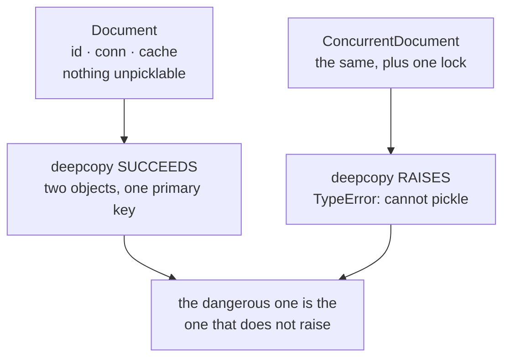

# Prototype

`[INTERMEDIATE]` · Create a new object by copying an existing one, rather than constructing it from
scratch.

Copying state is easy. **The pattern's entire difficulty is deciding what the copy must *not* carry
over**, and the list is always the same four: **identity, connections, locks, caches.** A `clone()`
whose body is `return deepcopy(self)` has not made that decision — it has deferred it to whoever
first notices two rows with the same primary key.

Every claim here is asserted by a test in
**[`18-implementations/prototype/`](../../18-implementations/prototype/)**.

---

## 1. One-line definition

An object that can produce a new instance of itself by copying its own state, used when
construction is expensive or when the desired starting state only exists at runtime.

## 2. Explain like I'm new

Sometimes making a thing is slow, and you already have one that is nearly right.

```python
doc = parse_and_validate_template(...)   # 400ms
copy1 = doc.clone()                      # microseconds
copy2 = doc.clone()
```

That is the whole idea. But a copy is *too* faithful by default — it also copies the things that
made the original *that specific object*: its database row id, its open connection, the cache it
had warmed up. A clone that inherits those is not a new object, it is a **second object pretending
to be the first**.

So a clone method is really two steps:

1. copy the payload (deeply — see §5b)
2. **reset everything that identified the original**

Step 2 is the pattern.

## 3. Real-world analogy

A golden machine image. You configure one server exactly right, snapshot it, and launch fifty.

And then the fifty all have the same SSH host key, the same `machine-id`, and the same hostname,
because the snapshot was too faithful. Every monitoring dashboard shows one host. Every SSH client
warns about a key mismatch. Nothing errored during the launch.

That is not a metaphor for the bug — **it is the same bug at fleet scale**, which is why image
builders ship a step whose entire job is to delete identity before sealing.

## 4. Technical explanation

### Every word of the definition, decoded

| Term | What it means |
|---|---|
| **prototype** | The existing instance being copied from. Often a registered template |
| **clone** | The new instance. Shares a class with the prototype and must not share its identity |
| **shallow copy** | Copies the attribute *bindings*. Nested objects are shared |
| **deep copy** | Recursively copies everything reachable. Slow, and faithful to a fault |
| **payload** | The state you *do* want copied |
| **identity** | The state that makes the original a particular thing: ids, handles, locks, caches |

### Why it exists at all

Two situations, and the second is the one people forget:

1. **Construction is expensive** and copying is cheap.
2. **The state you want only exists at runtime.** A parsed template, a warmed model, a game entity
   configured by a level designer. You cannot write it as a literal, so you prepare one instance
   and copy it.

Without the second, a factory function would do. It is the inability to *express* the desired
initial state in code that makes copying necessary.

## 5. Engineering at scale

### 5a. Python's protection here is an accident

Ask Python to copy a `threading.Lock` or a `socket` and it refuses — shallow **and** deep:

```
TypeError: cannot pickle '_thread.lock' object
```

And because one unpicklable field makes the **entire object** uncopyable, a class that happens to
hold a lock inherits that guard for free.

> **The first draft of this repository's implementation had a `_lock` on the example class.** So
> `copy.deepcopy(doc)` raised, and the headline claim — that the dangerous clone is the one that
> *succeeds* — was false of the very object written to demonstrate it. The file failed on the line
> asserting it.

That turned out to be the better lesson:

**The guard is incidental.** It comes from a field whose purpose is thread-safety, not copy
semantics. You get it by accident if your class happens to hold a lock, and you lose it by accident
the day someone moves locking up a layer — with nothing failing.



> *"You can't copy objects with handles"* is often remembered as a general safety net. **It is a net
> with one specific hole, and the hole is exactly where people fall.** A raw socket raises and saves
> you; a connection *wrapper*, a pool handle, a cursor proxy or a client holding a session token
> copies happily.

### 5b. Shallow against deep

The half everyone can recite and few check:

```python
shallow = copy.copy(doc)
shallow.sections.append("appendix")

doc.sections            # ["intro", "body", "appendix"] — the original changed
shallow.sections is doc.sections    # True — it is literally one list
```

`copy.copy` copies the bindings. `copy.deepcopy` fixes that and brings two new problems: it is slow,
and it **faithfully duplicates the things you most wanted dropped** — which is §5a.

### 5c. The four resets

```python
def clone(self, **overrides):
    new = type(self)(
        title=self.title,
        sections=copy.deepcopy(self.sections),   # deep: the payload is the point
        id=next(_ids),                           # reset: IDENTITY
        conn=None,                               # reset: CONNECTION
    )                                            # cache: empty by default
```

| Reset | Why | What happens if you don't |
|---|---|---|
| **Identity** — ids, sequence numbers, hostnames, keys | Two objects must not claim to be one row | A unique-constraint violation weeks later, on a table that has been collecting duplicates. The traceback points at the insert, not at the copy |
| **Connections** — handles, cursors, channels, sessions | A handle belongs to one owner | Closing one closes both; whichever is collected first takes the other's transport with it |
| **Locks** | **Both obvious answers are wrong** | Sharing makes two independent objects serialise against each other; copying leaves neither protected. Only a *new* lock is correct |
| **Caches** | Keyed to the original's content | The clone serves the prototype's rendering of a document it is no longer the same as |

**Drop the connection rather than sharing it.** Failing loudly when the clone is used without one
beats sharing a handle silently.

### 5d. The same bug at fleet scale

| In a process | In infrastructure |
|---|---|
| Clone inherits `id` | Golden image inherits `machine-id` and SSH host key |
| Clone inherits an open connection | VM template inherits a registered agent token |
| Clone inherits a warm cache | Container image bakes in a stale config pulled at build time |
| Two objects, one row | Fifty hosts, one identity, one line in the dashboard |

This is why image pipelines have a *sysprep* / `cloud-init clean` step whose only job is deleting
identity before sealing. It is §5c, in bash, at a different altitude — and it is the best argument
that this pattern is worth understanding even if you never write `clone()`.

## 6. The problem it solves

Creating an object whose desired initial state is expensive to produce, or impossible to express as
code because it was configured at runtime.

## 7. The problem it does NOT solve

- **Deciding what a copy means for your type.** It names the question; you answer it.
- **Deep copies of anything holding a resource.** §5a. Python refuses some and permits the worse
  ones.
- **Keeping the prototype pristine.** A spawn that reaches back into the template contaminates every
  later spawn — a registry whose prototypes drift is worse than no registry.
- **Polymorphic construction.** That is [Factory Method](../factory-method/).
- **Cost, generally.** How much cloning saves is entirely a property of your constructor.

## 9. How it works

### 9a. Python

```python
@dataclass
class Document:
    title: str
    sections: list[str] = field(default_factory=list)
    id: int = field(default_factory=lambda: next(_ids))
    conn: Connection | None = None
    _render_cache: dict[str, str] = field(default_factory=dict, repr=False)

    def clone(self, **overrides) -> "Document":
        new = type(self)(
            title=self.title,
            sections=copy.deepcopy(self.sections),
            id=next(_ids),
            conn=None,
        )
        for k, v in overrides.items():
            setattr(new, k, v)
        return new
```

`type(self)` rather than `Document`, so a subclass clones to its own type.

### 9b. Java

```java
public final class Document implements Cloneable {
    private final int id;
    private final List<String> sections;
    private transient Connection conn;          // transient: not carried by serialization either

    public Document copy() {                    // NOT named clone()
        return new Document(nextId(), new ArrayList<>(sections), null);
    }
}
```

**Do not implement `Cloneable`.** *Effective Java* Item 13 is unusually blunt about it: the
interface has no `clone` method, `Object.clone` is `protected`, it bypasses constructors so `final`
fields cannot be set, and it gives a shallow copy by default. A **copy constructor or static factory
is strictly better** — it is ordinary code, it can be typed properly, and it forces you to write the
resets by hand, which is the one thing you want to be forced to do.

### 9c. What a `clone()` must not be

```python
def clone(self):
    return copy.deepcopy(self)      # has decided nothing
```

Not that `deepcopy` is wrong — that it answers none of §5c's questions, and answers them all the
same way: **inherit everything.**

### 9d. The registry

```python
reg.register("report", Document.expensive("Template", ["a", "b"]))
spawned = [reg.spawn("report", title=f"doc-{i}") for i in range(5)]
# five documents, zero expensive constructions, five distinct identities
```

Named templates, built once, cloned per use. This is where the pattern earns its place.

## 13. When to use it

| Use it when | Because |
|---|---|
| Construction is **genuinely expensive** | Parsing, validation, a network fetch, model warm-up |
| The desired state **only exists at runtime** | You cannot write it as a literal, so you must copy one |
| You need **many near-identical variants** | Clone and override beats re-running setup |
| You are building **images, templates or snapshots** | §5d — this is the pattern, at scale |

## 14. When NOT to use it

- **Construction is cheap.** Call the constructor. Cloning is harder to reason about.
- **The object holds resources** you have not decided how to reset. Decide first.
- **An immutable object.** There is nothing to copy defensively; share it.
- **You want a different type.** That is a factory, not a clone.
- **As a shortcut past a messy constructor.** You have moved the mess, and made it implicit.

## 17. Trade-offs

| Axis | What you gain | What you give up |
|---|---|---|
| Cost | Expensive setup paid once | A deep copy of a large payload is not free either |
| Expressiveness | Captures runtime-configured state no constructor could | The starting state now lives in an object, not in code — harder to review |
| Correctness | — | Copy semantics are a persistent bug source. §5a, §5b |
| Safety | — | The language will not tell you what must not be inherited |

**The one sentence:** *cheap creation bought with copy-semantics hazards.*

## 18. Alternatives — the "why not?" table

| Instead of Prototype | Why | When it is right |
|---|---|---|
| **A factory function** | Explicit, no copy semantics to get wrong | Whenever the state *can* be expressed in code |
| **`dataclasses.replace`** | A variant of an immutable object, sharing nothing mutable | Frozen products — and it is what people usually want |
| **A copy constructor** (Java) | Ordinary, typed code; forces the resets | Always, over `Cloneable` |
| **Memoised construction** | `lru_cache` on the factory | The expensive part is deterministic and the result is immutable |
| **Share the immutable object** | No copy at all | The payload never changes |

## 19. Failure scenarios

| Architecture | What happens |
|---|---|
| **Monolith** | §5a–§5c. Duplicate ids and shared handles, silently |
| **Threaded** | A shared mutable payload between a prototype and its clones is a data race with no lock anywhere near it |
| **Container / VM fleet** | §5d. Duplicate machine identity across every instance launched from one image |
| **Database snapshots** | A restored snapshot carries the original's replication identity and sequence positions. Restoring into the same cluster without resetting them is the same bug with worse consequences |

### The distributed counterpart

**Container images · VM templates · snapshots.** The intent survives exactly and the difficulty
multiplies: *cloning state is easy; cloning identity is not.* A clone must not inherit leases,
client connections, replication slots or host keys — and at fleet scale nothing fails at the moment
of copying. It fails later, in monitoring, in SSH, in a replication topology that now contains two
nodes claiming one identity.

## 25. Without it → With it → New problem → Next

| Stage | State of the world |
|---|---|
| **Without it** | Every object re-runs a 400ms setup, or the runtime-configured state cannot be reproduced at all |
| **With it** | One prototype prepared; clones are cheap and carry state no constructor could express |
| **New problem** | Clones inherit the prototype's identity, connection and cache. Two objects claim one row, silently |
| **Next** | An explicit `clone()` that deep-copies the payload and resets the four |
| **And then** | The same pattern at fleet scale — and now the reset is a sysprep step, not a method (§5d) |

## 27. Implementation

**[`18-implementations/prototype/`](../../18-implementations/prototype/)** — runnable, stdlib only.

```bash
pytest test_prototype.py -q     # 16 tests
python prototype.py             # the same assertions, no test runner
```

Pinned there rather than claimed:

- `deepcopy` **succeeding** and returning a second object with the same id and the same connection
- two classes **one field apart** — one copies silently, one refuses — so the guard is visibly
  incidental
- `copy.copy` and `copy.deepcopy` both raising for `Lock`, `RLock` and `socket`, and a connection
  *wrapper* copying happily
- an explicit clone resetting identity, connection, lock and cache, one assertion each
- five spawns, **zero constructions**, five distinct identities
- a spawn that cannot contaminate its template

No `bench.py`: how much cloning saves is entirely a property of your constructor.

## 28. Common mistakes

1. **`clone()` that is just `deepcopy(self)`.** It decided nothing. §9c.
2. **Inheriting identity.** The classic production bug. §5c.
3. **Sharing a connection with the clone.** Closing one closes both.
4. **Copying a lock, or sharing one.** Both wrong; only a fresh lock is correct.
5. **Inheriting a warm cache** keyed to the original's content.
6. **Assuming Python will stop you.** §5a — it stops the easy case only.
7. **Shallow-copying a payload** and mutating the clone. §5b.
8. **A spawn that mutates its template.** Every later spawn inherits the change.
9. **Implementing `Cloneable` in Java.** §9b. Copy constructor.
10. **Sealing a golden image without stripping identity.** §5d.

## 30. Testing

1. **Mutate the clone's payload and assert the prototype did not change** — the shallow-copy bug in
   one line.
2. **Assert the clone's id differs.** Obvious, and it is the test that would have caught every
   duplicate-row incident this pattern has ever caused.
3. **Spawn twice from a registry and assert the second is clean** after mutating the first.
4. **Assert the connection is `None`, not "a connection".** "It has one" is the bug.

## 31. Exercises

**1. Find a `clone` that decided nothing.** Search a codebase for `deepcopy(self)` or a `copy()`
with no resets. List what it inherits.

**2. Remove a lock.** Find a class guarded incidentally by an unpicklable field, remove the field,
and confirm no test fails — then write the test that should have.

**3. Diff two instances from one image.** Launch two VMs or containers from the same image and
compare `machine-id`, host keys and hostnames.

**4. Restore a snapshot into the same cluster.** On a throwaway database. Observe what the
replication identity does.

<details>
<summary><strong>Interview: "Deep copy or shallow copy?" — and the follow-ups</strong></summary>

**The trap is answering the question as asked.** "Deep, because shallow shares nested objects" is
correct and is the junior answer. The senior one is that **neither is right on its own**: a deep
copy duplicates the things that must not be duplicated, so the real answer is *deep-copy the
payload and explicitly reset identity, connections, locks and caches.*

| Follow-up | What they want to hear |
|---|---|
| *"What must a clone never inherit?"* | The four. Volunteering them unprompted is the whole signal |
| *"Your object holds a DB connection."* | Drop it, do not share it. The clone must be given one, and failing loudly beats sharing silently |
| *"A lock?"* | A fresh one. Sharing serialises independent objects; copying protects neither |
| *"Does Python protect you?"* | Only incidentally — one unpicklable field guards the whole object, and a connection wrapper is not one |
| *"Java?"* | Copy constructor. Not `Cloneable` — *Effective Java* Item 13 |
| *"Where have you seen this at scale?"* | Golden images and VM templates, and the sysprep step that exists to strip identity |
| *"Why not just call the constructor?"* | Because the desired state was configured at runtime and cannot be written as a literal. That, not speed, is the real reason |

**What marks a senior answer:** treating it as a question about **identity**, not about copy depth.
</details>

## 33. Related

- **[Implementation](../../18-implementations/prototype/)** — the runnable version of every claim
- [Builder](../builder/) — the other creational pattern about an object's path into existence
- [Singleton](../singleton/) — where identity is the point, rather than the thing to strip
- [Factory Method](../factory-method/) · [Abstract Factory](../abstract-factory/)
- [Pattern catalogue](../CATALOGUE.md#prototype) · [Design patterns](../)
- [Monolith vs microservices](../../02-architecture/monolith-vs-microservices/) — where §5d's fleet
  of identical hosts comes from
- [Glossary: idempotency](../../GLOSSARY.md#idempotency)
