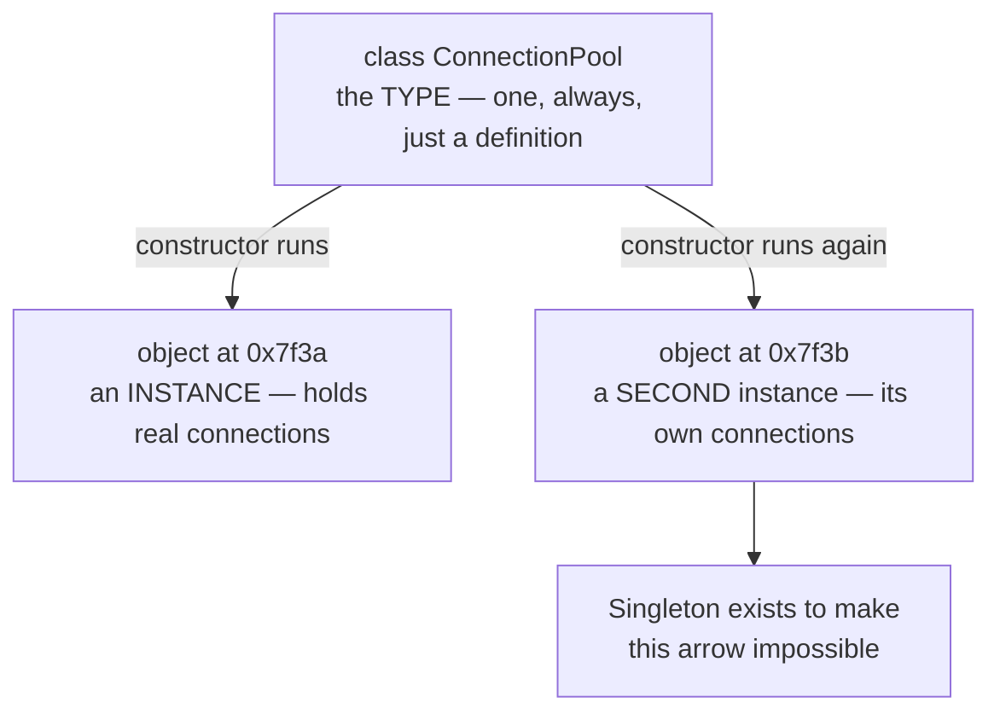
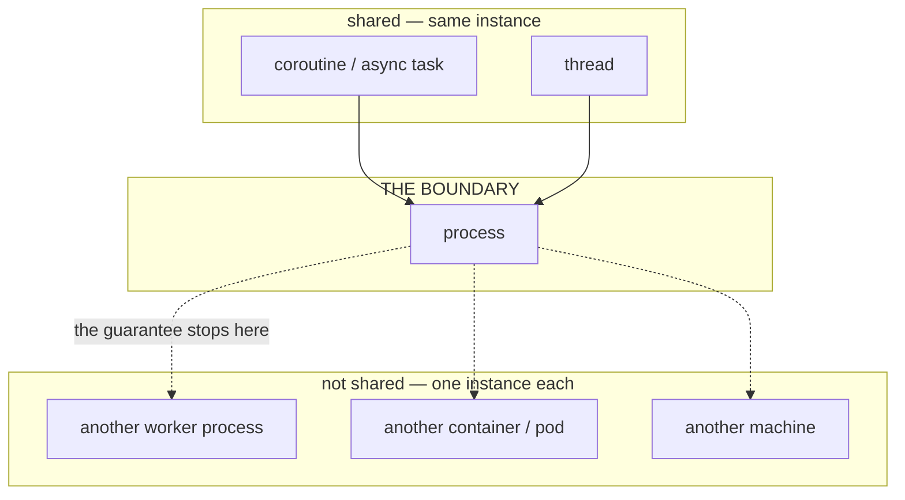
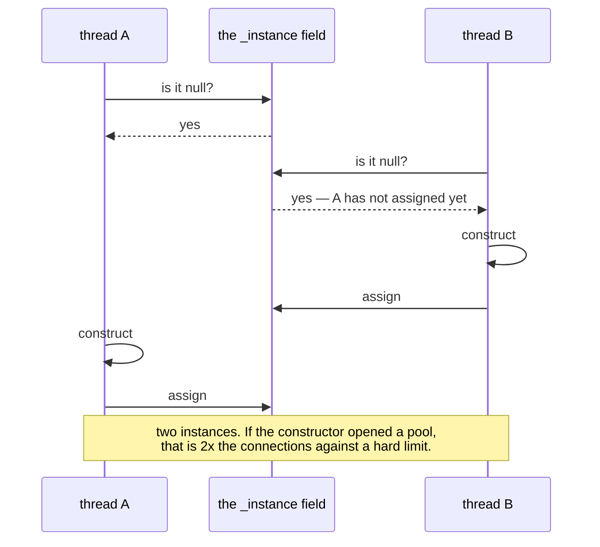
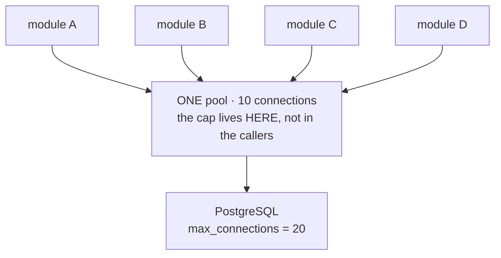
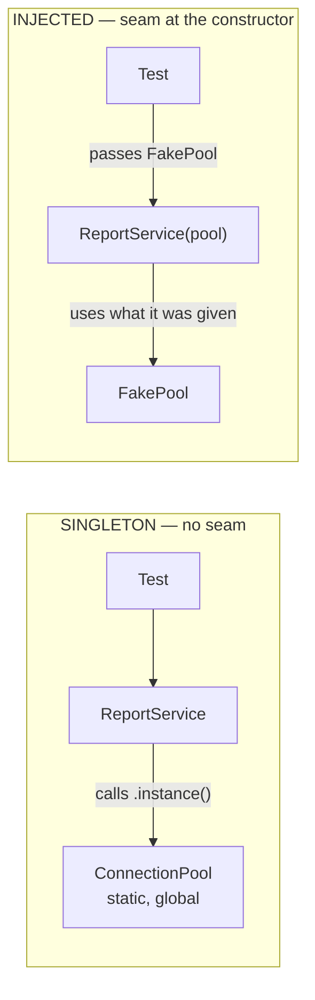
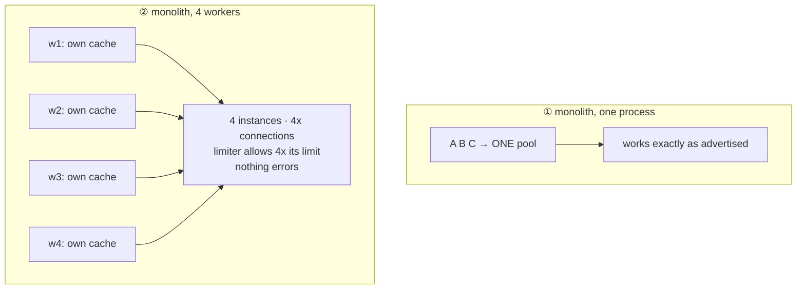

# Singleton

`[INTERMEDIATE]` · Exactly one instance, reachable from anywhere. Two promises in one pattern, and
almost every problem with it comes from the second. The famous difficulty — making creation
thread-safe — is the easy one; the two that cost real money are that **a safely-created instance is
not safe to use**, and that **"one" means one per process, and production runs many.**

Every claim on this page is asserted by a test or printed by a benchmark in
**[`18-implementations/singleton/`](../../18-implementations/singleton/)**. Run them.

---

## 1. One-line definition

A class that permits exactly one instance of itself to exist, and provides a global way to reach it.

## 2. Explain like I'm new

You need **one** of something, and you need to be able to get at it from anywhere.

The normal way to make an object lets anyone make as many as they like:

```python
a = ConnectionPool()   # one object
b = ConnectionPool()   # a completely separate second object
```

Singleton is machinery that makes the second line impossible. Ask for it twice, get the same object
both times. It does that by **locking the front door and leaving exactly one key on the wall.**

- The front door is the **constructor** — made private, so nobody outside can use it.
- The key on the wall is a **static method** — the one way in, which hands out the same object every
  time.

The reason this is controversial is the second half. Making one thing is uncontroversial. Making it
reachable from *anywhere* means every file can touch it without ever saying so.

## 3. Real-world analogy

A building has **one** main electrical panel. Not a design preference — there is one incoming supply,
and a second panel wired to the same supply would trip the main breaker.

So: the panel room is locked (private constructor), and there is a single key at reception that
anyone may ask for (static accessor). That gets you the two good properties.

Now the bad one. Nobody writes down who took the key. When a circuit goes down, the question *"who
changed something?"* has no answer, because the answer is *"anybody, at any time, and nothing
recorded it."* That is global mutable state, and it is the actual cost of this pattern — not
thread-safety.

The fix a careful building manager uses is not a better lock. It is a sign-out sheet: you still have
one panel, but now every access is **declared**. That is dependency injection, in §18.

## 4. Technical explanation

### Every word of the definition, decoded

The standard one-liner is *"a private constructor and a static accessor that lazily creates and
caches the instance."* That sentence is useless unless you already know the answer, so here is each
piece:

| Term | What it actually means | Its job in the pattern |
|---|---|---|
| **type** | A **class**. The blueprint. Written as "type" only because the pattern does not care *which* class — you pick one | the thing being restricted |
| **instance** | The actual **object in memory**, built from that blueprint, with its own data | the thing there is one of |
| **constructor** | The function that builds an instance — `__init__` in Python, `ClassName()` in Java | what has to be restricted |
| **private** | Marked so only this class may call it. Outside code **cannot** write `new Config()` | **blocks** the normal way in |
| **static** | Belongs to the **class**, not to an object — callable with nothing in hand | **provides** the only way in |
| **lazily** | Not built at program start; built the first time someone asks | avoids paying for the unused |
| **caches** | Stored in a variable, so the second call returns the *same* object | **guarantees** one |

A type and an instance are not the same thing, and the pattern is entirely about the gap between
them:



### Why the accessor *must* be static

This is the part that looks arbitrary and is not. You need a way to get the instance **before any
instance exists**.

- An ordinary method needs a `self` / `this` to be called on.
- `self` is the thing you are trying to obtain.

Chicken and egg. A static (or `@classmethod`) accessor is the only entry point that works when there
is nothing to call it on yet. `Config.getInstance()` is a message to the *class*, which exists from
the moment the program loads.

### It is seven properties, not two

"Unique and global" is the usual summary and it is too thin to reason with:

1. **Uniqueness** — one instance exists.
2. **Global access** — any code can reach it without being handed it.
3. **Lazy creation** — born on first use *(usual, not mandatory)*.
4. **Class-owned lifetime** — the class decides when it is born; the caller cannot create or
   normally destroy it.
5. **Shared mutable state** — if the instance has fields that change, **every** caller shares those
   changes.
6. **Non-substitutable** — callers get *the* instance, not *an* instance. Nothing can be swapped in.
7. **Scope-bound** — "one" is only true inside one boundary, and nobody tells you which. See §5.

**1–4 are the benefits. 5, 6 and 7 are the costs**, and they are the three that get left out.

## 5. Engineering at scale

### "One" — but one per *what*?

The single most useful thing on this page. The textbook never names the boundary, and the boundary
is where the pattern stops working.



- **Python** — the boundary is the interpreter's `sys.modules`. One process, one of those, one
  instance. Four Gunicorn workers are four processes, so **four instances**, each with its own cache
  and its own counters.
- **Java** — the boundary is actually the **ClassLoader**, not the process. `static` fields live in
  the `Class` object, which lives in a loader. One JVM normally has one application loader, so one
  instance — but an application server that gives each deployed webapp its own loader gives you
  **one singleton per webapp inside one JVM**. This surprises people.
- **Threads** — share it. Which leads directly to the next part.
- **asyncio** — all coroutines run in one thread, so a *synchronous* accessor has no race. But if
  creation itself awaits, the race is back:

  ```python
  async def instance(cls):
      if cls._instance is None:
          cls._instance = await build_pool()   # ← suspends; another task also sees None
  ```

  Fix that with `asyncio.Lock`, **not** `threading.Lock` — a threading lock blocks the whole event
  loop, converting a race into a stall.

### The under-taught one: safe to create ≠ safe to use

Thread-safe *creation* is the famous puzzle. Thread-safe *use* is the one that loses data, and it is
barely mentioned anywhere.

A singleton in a threaded server is created once, correctly, and then lives for the entire process
with **every request thread touching its mutable state simultaneously**. A lock around construction
says nothing about mutation.

```python
def bump(self):
    self.hits += 1    # reads, adds, writes — three steps, not one
```

Eight threads, eight increments, final value **1**. Nothing raises. The number is just wrong,
quietly, forever — and the singleton was implemented perfectly.
[`test_a_correctly_created_singleton_still_loses_writes`](../../18-implementations/singleton/) pins
it deterministically, and its partner test shows the fix is a **second, separate** lock: one decides
who builds the object, the other decides what happens to it afterwards.

<details>
<summary><strong>What is global mutable state?</strong></summary>

Data that (a) anything can reach and (b) anything can change.

```python
TOTALS = {}                 # global, mutable: both halves present

def handle(order):
    TOTALS[order.region] += order.amount     # who else writes this? unknowable
```

Either half alone is fine. A global *constant* is reachable but cannot change. A local *mutable* can
change but only one scope sees it. The combination is the problem: when the value is wrong, the list
of suspects is "the entire codebase", and the compiler cannot narrow it.

A singleton with any changing field is global mutable state by construction. One with no state —
a pure function holder — carries almost none of this pattern's cost.
</details>

## 6. The problem it solves

Some resources are genuinely singular, and creating a second does not duplicate a convenience — it
**duplicates a limit**. A connection pool sized at 10 *is* your cap of 10; a second pool makes it 20
against a database that will start refusing connections. See §13 for seven of these and exactly what
each one breaks.

## 7. The problem it does NOT solve

- **Uniqueness beyond the process.** The guarantee is process-local and does not extend one inch
  past it. Across replicas you need a lease and a fencing token. §19.
- **Thread-safe *use* of the instance.** §5.
- **Initialisation order.** Lazy creation means the instance is built by whichever caller happens to
  be first, which is not a property you chose and can change between releases.
- **Knowing who depends on it.** The accessor is invisible at every call site. Nothing in any
  signature records the dependency.
- **Configuration that changes at runtime.** A cached instance holds whatever it read at startup.

## 9. How it works

### 9a. The naive version — what everyone writes

```python
class Config:
    _instance = None

    def __new__(cls):
        if cls._instance is None:              # ← the entire bug lives on this line
            cls._instance = super().__new__(cls)
        return cls._instance
```

```java
public class Config {
    private static Config instance;
    private Config() {}                         // private: nobody else can construct

    public static Config getInstance() {
        if (instance == null) {                 // ← same line, same bug
            instance = new Config();
        }
        return instance;
    }
}
```

### 9b. Why it breaks

The check and the assignment are **two steps**, and a thread can be interrupted between them:



<details>
<summary><strong>What is a race condition?</strong></summary>

A bug whose presence depends on **timing** rather than on input. The same code, same data, runs
correctly a thousand times and wrongly on the thousand-and-first, because two threads interleaved
differently.

```python
if balance >= 100:      # thread A checks: 150, fine
    balance -= 100      # thread B already withdrew 100 — balance is now -50
```

What makes them expensive is not severity, it is **reproducibility**: a race that fires once a week
in production cannot be reproduced on demand, so it survives every attempt to debug it by running it
again. That is why the tests for this pattern *pin* the interleaving rather than retrying and hoping.
</details>

> **The Python-specific claim that trips people up:** the GIL does **not** save you. It guarantees
> one thread executes bytecode at a time; it does not make a multi-bytecode *sequence* atomic.
> `__new__` compiles to several instructions and a thread switch can land between the check and the
> store — and a constructor worth caching is slow by definition, which is exactly when it does.

### 9c. The fix — double-checked locking

```python
import threading

class Config:
    # A CLASS attribute, not an instance one — note there is no `self`. It lives
    # on the class object itself, so there is exactly ONE of these however many
    # callers there are. This is the slot the single instance is filled into:
    # it starts as None and is written once.
    _instance: "Config | None" = None

    # Also class-level. Guards the gap between "is it None?" and "assign it",
    # which is the only place two threads can collide.
    _lock = threading.Lock()

    @classmethod                                 # callable as Config.instance(),
    def instance(cls) -> "Config":               # with no object in hand — see §4
        if cls._instance is None:                # FAST PATH: already built, skip the lock
            with cls._lock:                      # only the first callers ever pay this
                if cls._instance is None:        # RE-CHECK: another thread may have won
                    cls._instance = cls()        # ← filled in HERE, exactly once
        return cls._instance                     # everyone after this gets this same object
```

**Why the check appears twice**, since this is the question the code raises:

- The **outer** check is outside the lock so that the overwhelming majority of calls — every call
  after startup — never touch it. Measured: that saves **55%** of the warm call
  ([`bench.py`](../../18-implementations/singleton/)).
- The **inner** check is inside the lock because between a thread's first check and its acquiring
  the lock, another thread can finish the entire job. Without the re-check the lock only makes the
  two builds *sequential*, which is not the property anybody wanted.
  [`test_the_inner_check_is_what_stops_a_second_build`](../../18-implementations/singleton/) proves
  exactly that: two builds, one lock, no error.

<details>
<summary><strong>What is double-checked locking, and why is it famous?</strong></summary>

Check without the lock, take the lock, check again. The first check is for speed, the second for
correctness.

It is famous for being the standard interview trap, because the Java version is **broken without
`volatile`** and the broken version looks right. It was in textbooks for years before the Java
Memory Model was revised to make `volatile` sufficient to fix it.

In Python it is correct as written above. It is also usually unnecessary — see §18.
</details>

### 9d. Java's version, and the trap

```java
public final class Config {                // final: nobody subclasses in a second one

    // `static` = belongs to the CLASS, not to an object: one copy of this
    // reference for the whole class, the natural home for "the one instance".
    // `volatile` = every thread reads the newest value, AND the JVM may not
    // move the constructor's writes after this assignment. Remove it and
    // another thread can observe a NON-NULL reference to a HALF-BUILT object.
    private static volatile Config instance;

    private Config() { }                   // the compiler now rejects `new Config()` outside

    public static Config getInstance() {
        Config local = instance;            // read the volatile field ONCE, not twice
        if (local == null) {                // fast path
            synchronized (Config.class) {   // lock on the Class object itself
                local = instance;
                if (local == null) {        // re-check under the lock
                    instance = local = new Config();
                }
            }
        }
        return local;
    }
}
```

<details>
<summary><strong>What does <code>volatile</code> actually prevent?</strong></summary>

Two distinct things, and the second is the one that bites.

1. **Visibility** — without it, a thread may read a stale cached copy of the field and never see
   another thread's write.
2. **Reordering** — the JVM is allowed to make `instance = new Config()` visible *before* the
   constructor has finished running. A second thread then sees a non-null reference, skips the lock
   entirely, and uses an object whose fields are still zero.

The second one is why the naive DCL was declared broken. It is not a theoretical concern on weakly
ordered hardware, and it produces a `NullPointerException` in a field that is obviously assigned —
the worst kind of bug report.

Python's object model does not expose this reordering, which is why §9c needs no equivalent.
</details>

### 9e. What you would actually ship

Neither of the above. Both languages already give you one-time initialisation for free.

**Python — a module-level object:**

```python
# config.py
config = Config(os.environ["DATABASE_URL"])   # module body runs ONCE, under the import lock
```

The import system already guarantees a module's body executes exactly once, under a lock, however
many files import it. A module-level object **is** a lazy, thread-safe singleton with nothing to get
wrong. Measured at **7x cheaper than the double-checked version**, and there is no incorrect version
to write by accident. Reaching for `__new__` in Python is Java habits leaking across.

**Java — the initialization-on-demand holder:**

```java
public final class Config {
    private Config() { }

    private static final class Holder {               // not loaded until first touched
        static final Config INSTANCE = new Config();
    }

    public static Config getInstance() { return Holder.INSTANCE; }
}
```

The JVM guarantees class initialisation is **once**, **lazy** and **thread-safe**. All three, free,
with no lock on the hot path.

**Java — or an enum, which is stronger:**

```java
public enum Config {
    INSTANCE;
    private final String dsn = System.getenv("DATABASE_URL");
    public String dsn() { return dsn; }
}
```

*Effective Java*, Item 3. The only form that survives **serialization and reflection**, both of
which can forge a second instance of an ordinary class — `readObject` returns a fresh one, and
`setAccessible(true)` defeats a private constructor outright.

<details>
<summary><strong>What is thread-safe lazy initialization?</strong></summary>

Three requirements at once, which is why it is harder than it sounds:

1. **Lazy** — do not build it until someone asks.
2. **Once** — however many threads ask simultaneously, build it exactly once.
3. **Safely published** — every thread that receives the reference sees a fully constructed object.

DCL does all three by hand. A module-level object (Python) and class initialisation (Java) do all
three as a language guarantee. Requirement 3 is the one hand-written versions forget, and it is the
one `volatile` is for.
</details>

## 13. When to use it

Seven real ones. Read the right-hand column first — **the pattern's purpose is clearest from what
breaks without it**.

| # | The singleton | What breaks if there are two |
|---|---|---|
| 1 | **Logger** | Two handles on one file → interleaved, truncated lines, timestamps out of order |
| 2 | **Config** | Different parts of the code read different values. "Works on my machine", one codebase |
| 3 | **DB connection pool** | The pool size *is* your connection limit. Two pools of 10 = 20. The database hits `max_connections` and starts refusing |
| 4 | **HTTP client** (`requests.Session`, `OkHttpClient`) | Keep-alive is only reused if the client is. A new client per call = full TCP + TLS handshake every request. This one silently triples p99 |
| 5 | **Metrics registry** | Counters accumulate in two places; whichever gets scraped reports half the traffic. The dashboard lies |
| 6 | **Cache** | Half the hit rate, two divergent copies of stale data, and invalidating one leaves the other wrong |
| 7 | **Thread pool / executor** | The pool size *is* your concurrency cap. Two pools = 2x the threads, and "max 10 concurrent" becomes a false promise |



An eighth, worth knowing because it is the nastiest: a **Snowflake-style ID generator**. Its node ID
must be unique; two instances sharing one emit **duplicate primary keys**, and you discover it weeks
later from a constraint violation on a table that has been quietly collecting them.

**The rule those seven share:** a singleton is right when the thing it wraps is a **finite external
resource**, or a **place where values must accumulate**. It is wrong when it is merely convenient to
reach.

## 14. When NOT to use it

- **Because passing an argument felt tedious.** That is the whole reason it has a bad reputation.
- **For anything with per-request state.** A singleton holding "the current user" is a data leak
  between concurrent requests, and it is the single most common catastrophic misuse.
- **When the uniqueness has to hold across processes.** §19. It will not, and nothing will tell you.
- **For anything a test needs to vary.** §30.
- **When the real requirement is "expensive, build it once".** That is caching, and
  `functools.lru_cache` or a module-level object does it without the global.

## 17. Trade-offs

| Axis | What you gain | What you give up |
|---|---|---|
| Resource safety | One pool, one cap, honoured | Nothing. This part is pure win |
| Convenience | Reachable from anywhere, no plumbing | Dependencies vanish from every signature |
| Construction cost | Paid once, lazily | Paid by whichever caller is first — not a chosen order |
| Testability | — | No seam. Tests need a `_reset()` hack and cannot run in parallel |
| Concurrency | Creation is solvable | Every thread shares its mutable state for the process's life |
| Distribution | — | The guarantee does not cross the process boundary, silently |

**The one sentence:** *uniqueness bought with global state and untestability.*

And the sharper version: **the real cost is not thread-safety, it is non-substitutability.**
Thread-safety is a solved puzzle with a known answer. Untestability is a design property you live
with for the life of the codebase.

## 18. Alternatives — the "why not?" table

| Instead of Singleton | Why | When it is the right call |
|---|---|---|
| **Module-level object** (Python) | Already exactly-once and thread-safe; 7x cheaper; nothing to get wrong | Default answer in Python |
| **`enum`** (Java) | Survives serialization and reflection | Default answer in Java when there is no construction argument |
| **Holder idiom** (Java) | Lazy and lock-free via class init | Construction is costly and may not be needed |
| **DI container, singleton scope** | One instance, but injected — uniqueness **without** global access | The production answer. See below |
| **Borg / Monostate** | Shares state instead of identity; callers construct normally | Rarely. `a is not b` while `a.x is b.x` violates what every reader assumes |
| **Just pass it in** | One argument, zero machinery | More often than people think |

### The one that matters: dependency injection

<details>
<summary><strong>What is dependency injection?</strong></summary>

Giving an object the things it needs, instead of letting it go and fetch them.

```python
# FETCHING — the dependency is invisible and unswappable
class ReportService:
    def run(self):
        pool = ConnectionPool.instance()      # reaches out; nothing can intercept this

# INJECTED — the dependency is declared and swappable
class ReportService:
    def __init__(self, pool):                 # the signature TELLS you what this needs
        self._pool = pool
    def run(self):
        ...self._pool...
```

That is the entire technique. It is passing an argument, given a name. You will meet it as Spring,
Guice or Dagger in Java; `Depends` in FastAPI; ASP.NET Core; Angular; NestJS. In plain Python it is
usually just constructor arguments and no framework at all — which is fine, and often better.
</details>

**How it is wired** — one place, called a *composition root*, creates one of each thing and passes
them in. Nothing else constructs anything.

```python
# main.py — the ONLY place that wires things together
pool    = ConnectionPool(os.environ["DATABASE_URL"])
cache   = Cache()
service = ReportService(pool, cache)
app     = make_app(service)
```

```java
@Configuration
class AppConfig {
    @Bean                                     // Spring's DEFAULT scope is singleton:
    ConnectionPool pool() { ... }             // the container holds exactly one

    @Bean
    ReportService reportService(ConnectionPool pool) {   // handed in, not fetched
        return new ReportService(pool);
    }
}
```

**Why bother**, in the order it will matter to you:

1. **Testability.** A test passes a fake. With `ConnectionPool.instance()` there is no seam between
   the two classes to get into.
2. **Visible dependencies.** `__init__(self, pool, cache, clock)` tells you this class touches a
   database, a cache and time. The fetching version tells you nothing until you have read every line
   of it.
3. **Lifetime control leaves the class.** The container decides singleton vs per-request vs
   per-call; the class stops caring.
4. **One wiring place.** Change what `ReportService` talks to by editing `main.py`, not by hunting
   every `.instance()` call in the repository.

**And the key insight.** Recall the two promises from §1 — uniqueness and global access. A DI
container's **singleton scope gives you uniqueness without global access**: one instance, handed in.
That is why it is the production answer. You keep the benefit and drop the cost.



The test on the left cannot get between `ReportService` and `ConnectionPool`. There is no parameter
to override and no interface to stub. It would have to reach into class state and reset it — and if
tests run in parallel, they now fight over one global.

## 19. Failure scenarios

How the pattern behaves in each architecture. **Only the first row is the textbook promise.**



| Architecture | What actually happens |
|---|---|
| **① Monolith, single process** | The only case where the promise is literally true. One instance, shared by everything |
| **② Monolith, multi-worker** — gunicorn, uWSGI, PHP-FPM, Node cluster, Puma | **N workers = N singletons.** Symptoms: hit rate stubbornly below expectation; an in-memory rate limiter admitting N× its limit; behaviour depending on which worker you landed on. **The most common place this pattern quietly stops working**, because nothing errors — it just under-delivers |
| **③ Threaded server** — Tomcat, a JVM web app | One process, one instance, hundreds of request threads using it at once. Correct creation is now the *easy* half; every mutable field needs `ConcurrentHashMap`, `AtomicLong` or a lock |
| **④ Microservices / Kubernetes** | Each replica is a process with its own instance. The classic incident: a `@Scheduled` method on a Spring singleton, scaled to 3 replicas — the nightly email goes out **three times**. Anything that must be globally unique needs a lease, leader election, or a unique constraint in the database |
| **⑤ Server-to-server** | No shared memory, so "singleton" means nothing across the wire. What you want is a **single logical owner** — one service owns that data and is its only writer — plus **idempotency keys** so a duplicate is harmless. Design for duplicates; you cannot distinguish a dead peer from a slow one |
| **⑥ Serverless** | One instance per warm container, count and lifetime both unpredictable. The standard advice *"create the DB client outside the handler"* **is** this pattern, used deliberately for connection reuse. Never store state in it that you need later |

### The distributed counterpart

Across processes this becomes **leader election**, and it is harder for the reason every distributed
counterpart is harder: you cannot distinguish a dead node from a slow one, so two nodes can both
believe they are the singleton. The fix is not a better lock.

<details>
<summary><strong>What is a fencing token?</strong></summary>

A number that increases every time a lock is granted. The protected resource rejects anything
carrying an older one.

```
node A acquires the lock, token 33  → pauses (a long GC)
the lease expires
node B acquires the lock, token 34  → writes
node A wakes up, writes with token 33  → REJECTED, 33 < 34
```

Without it, a paused node wakes and writes with authority it no longer holds, and the lock service
did nothing wrong — A really did hold the lock when it checked. The token moves enforcement to the
resource, which is the only place that can actually refuse. This is why "we use Redis for locking"
is an incomplete answer.
</details>

## 25. Without it → With it → New problem → Next

| Stage | State of the world |
|---|---|
| **Without it** | Every module constructs its own pool. 40 connections against a limit of 20; the database refuses, and the error surfaces somewhere unrelated |
| **With it** | One pool, one cap, honoured. Connection errors stop |
| **New problem** | The dependency is now invisible — no signature mentions it — and tests cannot substitute it. A test suite that passes individually starts failing as a suite |
| **Next** | Register the single instance in a DI container, or just pass it from a composition root. Same uniqueness, visible and substitutable (§18) |
| **And then** | Scale to 4 workers and the uniqueness silently becomes per-worker. Now you need a lease and a fencing token (§19) |

## 27. Implementation

**[`18-implementations/singleton/`](../../18-implementations/singleton/)** — runnable, stdlib only.

```bash
pytest test_singleton.py -q     # 8 tests, no sleeps
python singleton.py             # the same assertions, no test runner
python bench.py                 # 4 real processes, 4 singletons
```

Everything this page claims is pinned there rather than asserted:

- the naive race builds **8 instances** from 8 threads, with the interleaving *pinned* rather than
  slept for — a race test that sleeps can only report "it did not show up this time"
- the locked version builds **1**, and proves the other seven threads *arrived and were held out*
- a correctly-created singleton still **loses 7 of 8 increments**
- four real processes report **four distinct instances**, and a limiter set to 100 admits 400
- the outer check saves **55%**; a module-level global is **7x cheaper than either**

The README there also documents two measurements this repository got **wrong** first — a vacuous
lock test that passed with the lock deleted, and a benchmark that compared the wrong two things and
reached the opposite conclusion.

## 28. Common mistakes

1. **Thinking the GIL makes it safe.** It serialises bytecode, not sequences. §9b.
2. **Omitting `volatile` in Java DCL.** Another thread sees a half-constructed object. §9d.
3. **Omitting the inner re-check.** The lock then makes two builds *sequential* rather than
   preventing one. Proved in the tests.
4. **Locking creation and assuming the instance is now thread-safe.** The expensive one. §5.
5. **Assuming "one" means one per deployment.** It means one per process. §19.
6. **Putting per-request state in it.** Concurrent requests see each other's data. The worst one.
7. **A `@Scheduled` job on a singleton in a scaled service.** It fires once per replica. §19.
8. **Adding `reset()` so the tests pass.** That method is a bug report about the design, not a fix.
9. **Writing `__new__` in Python** when a module-level object is shorter, faster and correct. §9e.
10. **Reaching for `functools.cache` as a shortcut.** It does not guarantee single invocation under
    contention, so it solves caching and not uniqueness.

## 30. Testing

The tell that a singleton is hurting you: **a test that passes alone and fails in a suite.** That is
state surviving from an earlier test, and it is the pattern's cost arriving as a flaky CI run rather
than as a design review comment.

Three ways out, worst to best:

1. **A `_reset()` classmethod.** Works, and makes parallel test execution impossible, because two
   tests now share one object. The implementation here carries one, deliberately, so the cost is
   visible rather than argued about.
2. **Patch the accessor** (`unittest.mock.patch`). No production change, but every test must know the
   import path it is patching, so the tests become coupled to the internals.
3. **Inject it.** No reset, no patching, parallel-safe. The last test in the implementation needs a
   single line of setup where every other test in the file needs the fixture — that contrast is the
   argument.

## 31. Exercises

**1. Make it thread-safe.** Write the naive version from §9a, then fix it. Then run
[`test_the_inner_check_is_what_stops_a_second_build`](../../18-implementations/singleton/) and
explain in one sentence why removing the inner check leaves a bug the lock does not fix.

**2. Break your own Java implementation.** Using only `java.io` and `java.lang.reflect`, obtain a
second instance of a private-constructor singleton. Then do it to an `enum` and explain why you
cannot.

**3. Count the instances.** Take any service you have running under more than one worker, and have
its in-memory counter report its own pid. Predict the number of distinct pids before you look.

**4. Find the per-request state.** In a codebase you know, find a singleton holding something that
belongs to one request. If concurrency is low you have not had the bug yet; you have the
vulnerability.

<details>
<summary><strong>Interview: "Implement a thread-safe Singleton." — what a strong answer does</strong></summary>

**Order matters more than the code.**

1. **Ask what it is for.** A logger and a connection pool have different answers. A candidate who
   starts typing has skipped the only question that changes the design.
2. **Give the simplest correct form for the language** — module-level in Python, `enum` or the holder
   idiom in Java. Not DCL. DCL is the answer to "write DCL", not to "write a singleton".
3. **Name the race before being asked.** Check-then-act, two steps, one interleaving.
4. **Say unprompted that you would normally use DI singleton scope instead**, and why: uniqueness
   without global access.
5. **Volunteer the process boundary.** Almost nobody does, and it is the thing that actually breaks
   in production.

**The follow-ups, and what each is really testing:**

| Follow-up | What they want to hear |
|---|---|
| *"Now make it thread-safe"* | DCL **and** `volatile`, or holder/enum — and why `volatile` is not optional |
| *"Why check twice?"* | Outer for speed, inner for correctness. Both, with the reason for each |
| *"Now make it testable"* | That you reach for injection, not a `reset()` hack |
| *"It's correct. Is the instance safe to use?"* | **No** — and that this is the bigger problem. Most candidates stop at creation |
| *"Two JVMs? Two pods?"* | That process-local uniqueness means **nothing** distributed. Lease, leader election, **fencing token** |
| *"Is it ever right?"* | Yes — genuinely unique resources, §13. "Never use it" is not the senior answer |
| *"Break your own implementation"* (Java) | Serialization and reflection. `enum` survives both |

**What distinguishes a senior answer:** it treats the pattern as a **scope decision**, not a
threading puzzle. "One per what?" is the question underneath all seven follow-ups.
</details>

## 33. Related

- **[Implementation](../../18-implementations/singleton/)** — the runnable version of every claim here
- [Pattern catalogue](../CATALOGUE.md#singleton) — where this sits among the 23 Gang of Four patterns
- [Design patterns](../) — and why a system design repository keeps GoF at all
- [Rate limiter](../../18-implementations/rate-limiter/) — the component §19's multi-worker row
  silently breaks
- [LRU cache](../../18-implementations/lru-cache/) — the other thing usually held in a singleton
- [Monolith vs microservices](../../02-architecture/monolith-vs-microservices/) — where the process
  boundary stops being an implementation detail
- [Circuit breaker](../../08-reliability/circuit-breaker/) — another object whose state must be
  shared, with the same per-process caveat
- [System Design Thinking](../../SYSTEM-DESIGN-THINKING.md) — the chain that forces a shared pool in
  the first place
- [Glossary: consensus](../../GLOSSARY.md#consensus) · [idempotency](../../GLOSSARY.md#idempotency)
