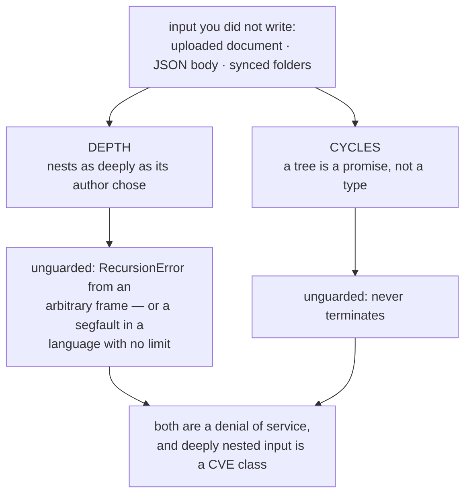

# Bridge, Composite, Flyweight

`[INTERMEDIATE]` · The three structural patterns that are **not** wrappers.

[The other four](../wrappers/) — Adapter, Decorator, Proxy, Facade — share a page because telling
them apart *is* the content. These three are never confused with each other. What they share is a
problem shape:

```
Bridge      too many CLASSES     N abstractions × M implementations
Composite   too many NODES       a tree the caller should not have to walk
Flyweight   too many INSTANCES   a million objects holding ten distinct values
```

**Three answers to "there are too many of these."** Each is sold on a claim that is arithmetic or a
failure mode rather than taste, so each claim is asserted by a test in
**[`18-implementations/structural/`](../../18-implementations/structural/)**.

---

## Part 1 · Bridge

### What it is

Separate an abstraction from its implementation so the two hierarchies vary independently. The
abstraction **holds** a reference to an implementation interface rather than inheriting from it.

```python
class Shape:
    def __init__(self, renderer: Renderer) -> None:
        self._renderer = renderer          # holds, does not inherit

class Triangle(Shape):
    def draw(self) -> str:
        return self._renderer.line("a", "b")

Triangle(SvgRenderer())      # 2 shapes × 2 renderers from 4 classes, not 4 combinations
```

### The crossover, which is the only thing worth memorising

N×M against N+M is the pitch. Where it stops being true is the useful part:

| | explicit (N×M) | bridge (N+M) | verdict |
|---|---|---|---|
| **1 × M** | M | **M + 1** | **worse, at every M, forever** |
| 2 × 2 | 4 | 4 | a tie, plus an indirection |
| 2 × 3 | 6 | 5 | it starts paying |
| 4 × 5 | 20 | 9 | |
| 10 × 10 | 100 | 20 | |

> **With a single abstraction or a single implementation, a bridge is not "a bit speculative" — it
> is strictly more classes than not having it, at every size.** That is the arithmetic behind the
> catalogue's advice to reach for it only when both axes are *actually* varying, and most codebases
> have one backend and always will.

The honest test before adding one: **name the second implementation, and say when it ships.** If
you cannot, the bridge is costing a class and an indirection to save nothing.

### It is Strategy wearing different clothes

Structurally identical — an object holding an interface it delegates to. They differ in **intent**:

| | Bridge | Strategy |
|---|---|---|
| Why | Two hierarchies must evolve separately | Swap one algorithm |
| Lifetime | Usually fixed at construction | Often swapped at runtime |
| Shape | **the same** | **the same** |

No test tells them apart, and no reviewer can either. Worth knowing before the argument starts.

### Distributed counterpart

**Storage and driver interfaces · pluggable backends.** JDBC is the canonical one, and it works for
the reason [Abstract Factory's cloud abstraction](../abstract-factory/) fails: a specification
forced every driver to the same surface. The catalogue's note is the one to carry — *implementations
differ in failure modes, not only in method bodies*. Two drivers that satisfy the same interface can
have entirely different timeout, retry and partial-failure behaviour, and the bridge hides that.

---

## Part 2 · Composite

### What it is

Leaf and container implement the same interface; the container delegates to its children. A caller
holding one file and a caller holding a thousand-node tree write the same code.

### What the uniformity costs

**The interface becomes the union of leaf and container needs.** `add(child)` is meaningless on a
file. There are three ways out and all are compromises:

| Option | Cost |
|---|---|
| **Raise on a leaf** | The uniformity is now conditional — callers must know after all |
| **No-op on a leaf** | Silent data loss. The caller never finds out |
| **Drop the method** | Honest, and the pattern's benefit goes with it |

The implementation raises, because a silent no-op is the only one of the three that loses data.

### Two hazards, both reachable from user input



The guard must fire **below** `sys.getrecursionlimit()`, so the error names the offending node. A
`RecursionError` tells you nothing about which input caused it.

### Two details the obvious implementation gets wrong

Both of these were wrong in this repository's first version, and both passed its first test suite:

**Cycle detection must key on identity, not name.** But the obvious test for that proves nothing —
two siblings sharing a name never collide, because the path is scoped per branch. It only breaks
when a node repeats one of its own **ancestors**: `src/lib/src/index.js`, or anything vendored.

**It must track the ancestor path, not every node visited.** A single accumulating `seen` set
rejects a **diamond** — one node legitimately reachable by two routes — and calls it a cycle. That
is a DAG, not a cycle, and the distinction is the difference between "visited before" and "is an
ancestor of where I am now".

```python
shared = Node("shared", size=7)
tree = Node("root").add(Node("left").add(shared)).add(Node("right").add(shared))

total_size(tree)     # 14 — reached twice, counted twice, not rejected
```

### The distributed one, and it is the number to remember

**A scatter-gather returns when its slowest member does**, so the composite is slow whenever *any*
member is:

| Members | P(at least one slow), each at p99 |
|---|---|
| 1 | 1.0% |
| 10 | 9.6% |
| **100** | **63.4%** |
| 1000 | 100.0% |

> **Each member's 99th percentile is roughly the composite's median.** A per-shard p99 everyone is
> pleased with becomes the typical experience of the aggregate.

`1 - 0.99^100 = 0.634`. This is *The Tail at Scale*, and three consequences follow:

1. **Fan-out width is an availability decision**, not only a throughput one. Going from 10 shards
   to 100 made the typical request slow.
2. **Reporting the mean of a fan-out is reporting nothing.** `[5, 6, 7, 900]` has a mean of 230ms
   and a real cost of 900ms.
3. It is why **hedged requests** exist — duplicate after p95, take the first answer — and why they
   are in the [resilience patterns](../CATALOGUE.md#resilience-patterns) rather than here.

---

## Part 3 · Flyweight

### What it is

Share one immutable object across many users, splitting state into:

- **intrinsic** — shared, identical for every user, lives in the flyweight
- **extrinsic** — per-use, differs every time, stays with the caller

```python
a, b = style("Inter", 12), style("Inter", 12)
assert a is b                        # the same object, not an equal one
```

**Returning the identical object rather than an equal one is the entire saving.** Splitting the two
kinds of state is the design work: put `position` in the flyweight and you have a million
flyweights and no saving; leave `font` out and two glyphs share a position.

### The one hard requirement

**A flyweight must be immutable.** Not as tidiness — it is shared *by construction*, so a mutable
one lets any holder change every other holder's data, and the bug surfaces arbitrarily far from the
mutation, in code that never touched the object.

### Python already does this

```python
s1, s2 = "".join(["ab", "cd"]), "".join(["ab", "cd"])
s1 == s2 and s1 is not s2          # True — equal, two objects
sys.intern(s1) is sys.intern(s2)   # True — and now one
```

`sys.intern` is a flyweight factory in the standard library, and the CPython small-integer cache is
another.

> **A warning about the usual demonstration:** `1000 is 1000` evaluates to `True` inside one code
> object, because the compiler folds equal constants. That looks like interning and is not, so it
> is the wrong thing to show. Built strings are the honest demonstration.

### The version you will actually meet

**Dictionary encoding in a columnar store is Flyweight at the storage layer.** Parquet, ORC and
ClickHouse store a low-cardinality column as a dictionary of distinct values plus an array of small
integers — intrinsic state once, extrinsic state (the row) holding a reference.

```
["GET","POST","GET","GET","DELETE", ...]        10,000 rows, ~34 KB of strings
  ->  dictionary ["GET","POST","DELETE"]  +  codes [0,1,0,0,2, ...]
                                                     ~10 KB, losslessly
```

It is the single largest reason columnar formats beat row formats on categorical data — and the
saving only holds while cardinality stays low enough for a small code, which is what "low
cardinality" means and why the implementation asserts it rather than quoting a byte count that
would stop being true.

---

## Part 4 · Choosing between them

| Symptom | Pattern | And the test before you reach for it |
|---|---|---|
| "We have `SvgCircle`, `CanvasCircle`, `PdfCircle`, `SvgSquare`…" | **Bridge** | Name the second implementation and say when it ships. If you cannot, do not |
| "Callers keep writing `if isinstance(x, Folder)`" | **Composite** | Can the interface honestly serve both? If `add` on a leaf has no sane answer, reconsider |
| "A million objects, and `set(id(...))` shows ten distinct values" | **Flyweight** | Is the shared part genuinely immutable? If not, fix that first |

**None of these is a wrapper**, which is the cleanest way to separate them from
[the other four](../wrappers/): a wrapper has an inner object it forwards to. A bridge has a
collaborator, a composite has children, and a flyweight has nothing — it *is* the shared thing.

---

## Part 5 · Interview

| Question | What they want |
|---|---|
| *"Bridge or Strategy?"* | **The same shape**, different intent: two hierarchies evolving separately against swapping one algorithm. Saying they are structurally identical is the signal |
| *"When is a Bridge wrong?"* | With one implementation it is **strictly more classes**, at every size. Name the second one or do not add it |
| *"What's the risk in a Composite?"* | Depth and cycles, both from user input, both a denial of service. Then the interface weakening |
| *"You fan out to 100 shards, each p99 = 1%."* | **63% of requests are slow.** Each member's p99 is the composite's median. This is the one that separates people |
| *"Why is the mean useless there?"* | The composite costs its slowest member, not its average |
| *"Where have you seen Flyweight?"* | String interning — and **dictionary encoding in Parquet**, which is the version that matters |
| *"What must a Flyweight guarantee?"* | Immutability. It is shared by construction |

**What marks a senior answer:** treating all three as responses to a **counting problem** — too many
classes, too many nodes, too many instances — and knowing the arithmetic for each.

---

## Part 6 · Implementation

**[`18-implementations/structural/`](../../18-implementations/structural/)** — runnable, stdlib only.

```bash
pytest test_structural.py -q     # 19 tests
python structural.py             # the same assertions, no test runner
```

Pinned there: `crossover(1) is None` and `crossover(2) == 3`; the depth and cycle guards firing
with named errors; a diamond **not** rejected; `1 - 0.99^100 = 0.634`; 11,000 glyphs sharing one
style object; `sys.intern` identity; and dictionary encoding measured at 3× smaller.

Then **seven deliberate breaks**, each expected to fail a named test. Two of them initially slipped
through, and that is how both of this page's "details the obvious implementation gets wrong" were
found:

- keying cycle detection on **name** passed the whole suite, because the first test put the
  duplicate names in sibling branches where they can never collide
- **accumulating** visited nodes instead of scoping to the ancestor path was a real bug here — the
  code rejected a diamond while its own docstring claimed DAGs were fine

A guard nobody has watched fire is a guess, and a docstring nobody has tested is a wish.

## Related

- **[Implementation](../../18-implementations/structural/)** — the runnable version of every claim
- [Wrappers](../wrappers/) — Adapter, Decorator, Proxy, Facade: the other four structural patterns
- [Abstract Factory](../abstract-factory/) — why JDBC's symmetry works and cloud abstraction does not
- [Latency](../../00-foundations/latency/) — the foundation under Part 2's tail arithmetic
- [Caching](../../04-caching/fundamentals/) — where intrinsic/extrinsic appears as what is worth keeping
- [Pattern catalogue](../CATALOGUE.md#bridge) · [Design patterns](../)
- [Types of system design](../../SYSTEM-DESIGN-TYPES.md) — why the low-level layer is kept here
