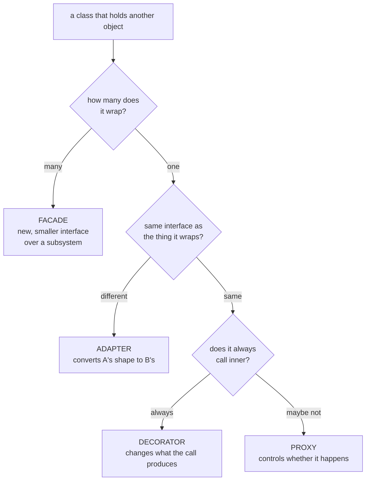

# Adapter, Decorator, Proxy, Facade

`[INTERMEDIATE]` · Four patterns, one skeleton. An object that holds another object and exposes a
method you call instead.

```python
class Wrapper:
    def __init__(self, inner): self._inner = inner
    def do(self, x):           return self._inner.do(x)
```

**That is all four.** They differ only in *intent* — which is why four separate pages would be the
wrong shape: the distinction exists in comparison and nowhere else. Every one of them, read alone,
sounds obviously correct and obviously distinct, and then you meet a class in a real codebase and
cannot say which it is.

Every claim here is asserted by a test in
**[`18-implementations/wrappers/`](../../18-implementations/wrappers/)**.

---

## 1. Telling them apart

Two questions settle almost every argument:



| | Interface vs what it wraps | Calls inner? | Wraps | Stackable |
|---|---|---|---|---|
| **Adapter** | **different** | always | one | no |
| **Decorator** | same | **always** | one | **yes — that is the point** |
| **Proxy** | same | **maybe not** | one | rarely |
| **Facade** | **new and smaller** | always | **many** | no |

### The hard pair, and the sharpest test for it

Decorator and Proxy are the genuinely difficult distinction. Everyone reaches for "a decorator adds
behaviour and a proxy controls access", which is true and does not help, because every proxy adds
*something*.

> **Proxy decides *whether* the inner call happens.
> Decorator changes *what happens around* a call it always makes.**

A caching proxy may never touch the inner object. A gzip decorator cannot avoid it — it needs a
result to transform. And unlike the usual phrasing, this is a property you can measure:

```python
deco, prox = GzipDecorator(r1), CachingProxy(r2)
deco.render(); deco.render()
prox.render(); prox.render()

assert r1.renders == 2      # a decorator always forwards
assert r2.renders == 1      # a proxy decides
```

Same interface, same two calls, same wrapped object. **One integer.**

The other half matters too: **no type system separates them.** Both satisfy the protocol, both take
an inner of it, both return the declared type. If you are trying to tell them apart by reading the
signature, there is nothing there.

### Two more discriminators worth memorising

- **If a wrapper's interface matches what it wraps, it is not an Adapter**, whatever the class is
  called. `FooAdapter` with the same methods as `Foo` is a decorator or a proxy.
- **A wrapper around one object is never a Facade.** A facade exists because the caller would
  otherwise have to know a *sequence* across several objects, and the sequence is what is hidden.

## 2. Each one, briefly

### Adapter — the interface changes

```python
class LegacyAdapter:
    def __init__(self, legacy): self._legacy = legacy
    def render(self) -> bytes:                              # our interface
        return self._legacy.generate_document().encode()    # theirs
```

The precondition is that **you do not own the other side**. If you own both, an adapter is debt:
fix the interface.

Adapters do not stack, because there is nothing to compose — two translations in a row means one of
them was aimed at the wrong target.

**What the top 1% do differently** (from the catalogue, and it is the sharpest thing on this page):
they use it as a boundary for the *domain model*, not merely for method signatures — a true
**anti-corruption layer**. The failure they avoid is an adapter that mirrors the vendor's model
one-to-one, which spreads the vendor's concepts through your code **while adding a layer**. You
paid for the indirection and got none of the containment.

### Decorator — same interface, always forwards, stacks

```python
EncryptDecorator(GzipDecorator(report))
```

The constructor takes the interface and the class implements it, which is what makes nesting work
and is the whole reason the pattern exists: subclassing for every combination of optional
behaviours explodes combinatorially, and composing at runtime does not.

**The cost is debuggability.** A stack trace forty frames of wrappers deep tells you nothing, and
the order is invisible at the call site — see §4.

### Proxy — same interface, decides whether to forward

Four kinds, and they are worth naming because people think "proxy" means only the last one:

| Kind | What it controls |
|---|---|
| **Virtual / lazy** | *When* the real object is created. The ORM relation |
| **Caching** | *Whether* the call happens at all |
| **Protection** | *Who* may call |
| **Remote** | *Where* it happens — and this one can fail independently |

**The transparency is the danger.** A call that looks local is a network round trip or a lazy load.
§5 is the production consequence.

### Facade — many objects, a new and smaller interface

```python
def publish(self, report, key, to) -> str:
    url = self._storage.put(key, report.render())
    self._notifier.notify(to, url)
    return url
```

The sequence is the thing being hidden. **And it must not become the only door** — the moment it
is, every capability some caller eventually needs has to be added to it, and it accretes into a god
object. That erosion is documented in detail on the [API gateway page](../api-gateway/), which is a
facade that became a deployment bottleneck one reasonable request at a time.

## 3. Why these are in a system design repository

**All four reappear at the network layer**, and that is the argument for keeping Gang of Four in a
systems context:

| In one process | Across a network | What distribution added |
|---|---|---|
| **Adapter** | Anti-corruption layer, protocol translation gateway | The adapter now fails independently of both sides it adapts |
| **Decorator** | Middleware chain, service mesh sidecar, filter chain | Each decorator is a network hop with its own latency and its own failure mode |
| **Proxy** | Reverse proxy, sidecar, read-through cache | A remote proxy can be reachable while its subject is not — exactly the case needing a timeout and a [circuit breaker](../../08-reliability/circuit-breaker/) |
| **Facade** | API gateway, backend-for-frontend | It becomes a single point of failure *and* a release bottleneck for every team behind it |

**Your web framework's middleware is Decorator.** Your service mesh sidecar is Proxy. Your BFF is
Facade. The patterns did not become irrelevant at scale; they changed altitude and acquired failure
modes.

## 4. Order is part of the design, and invisible at the call site

Two stacks, six characters apart, both type-checking, both running:

```python
GzipDecorator(EncryptDecorator(report))     # encrypt, then compress
EncryptDecorator(GzipDecorator(report))     # compress, then encrypt
```

Measured:

```
raw                      9600 bytes
compress -> encrypt        80 bytes
encrypt  -> compress     9611 bytes     ← larger than the input
```

**120×**, and the wrong one is *bigger than the raw data*: ciphertext has no exploitable structure,
so zlib finds nothing and adds framing.

The generalisable point is not about compression. **In a middleware stack the ordering is the
security model.** Auth-then-log and log-then-auth are different systems — one of them writes
credentials of unauthenticated callers into your log pipeline. Rate-limit-before-auth and
auth-before-rate-limit differ in whether an unauthenticated flood can exhaust your auth service.

Nothing at the call site shows which one you built, which is why the catalogue's advice is to keep
the chain shallow and **make the order explicit and reviewable**.

<details>
<summary><strong>Is compress-then-encrypt always right?</strong></summary>

No, and the exception is a good one to know.

For a log file, compress first — otherwise compression buys nothing (above).

For anything where **an attacker controls part of the plaintext and can observe the compressed
length**, compressing first leaks information: the attacker injects guesses and watches the output
shrink when a guess matches content already present. That is **CRIME** and **BREACH**, and it is
why TLS-level compression was removed.

So: compress first for a log file, do not compress at all for a session cookie. "Order matters" is
the lesson; which order is a question about the threat model.
</details>

## 5. The most expensive proxy in production

```python
rows = [LazyRow(k, store) for k in store]    # "one query" to list them
assert QUERIES == []                         # constructing touched nothing

values = [r.value for r in rows]             # looks like attribute access

assert len(QUERIES) == 100                   # 1 + N
```

This is every ORM's lazy-loaded relation, and it is the **single most common performance bug in web
applications**. The call site reads like it is touching fields on objects it already has.

**The transparency is the bug.** A proxy that hid the cost badly would have been caught in review;
this one hides it perfectly. Which is why the catalogue's advice is to make the expensive case
*visible* rather than seamless — and why the only reliable way to find it in a running system is to
instrument the driver and count.

Three things that actually help: eager-load explicitly at the query boundary, log a warning when a
lazy load happens inside an iteration, and **count queries per request in tests** — a test that
asserts "this endpoint issues at most 3 queries" catches the regression that no functional test
can see.

## 6. The wrapper tax, and the trap people reach for

**Every wrapper must forward every method.** One interface method is cheap; five methods and four
wrappers is twenty delegating bodies, and adding a sixth is four edits. The same O(N) asymmetry
[Abstract Factory](../abstract-factory/) charges for a new product, for the same structural reason.

`__getattr__` looks like the escape hatch. It is a trap:

```python
wrapped = MagicWrapper(report)

wrapped.render()        # fine — ordinary methods forward
wrapped.rows            # fine — so do attributes
len(wrapped)            # TypeError, while len(report) works
```

**Python looks special methods up on the type, not on the instance**, so `__getattr__` is never
consulted for them. The wrapper is a drop-in replacement right up until someone calls `len()`,
indexes it, iterates it, compares it, or puts it in an f-string — and it passes every test that
calls methods.

## 7. When NOT to wrap

- **Adapter when you own both sides.** Fix the interface; the layer is debt.
- **Decorator past three deep.** The stack trace stops being readable and the order stops being
  reviewable. The catalogue's advice is to keep the chain shallow for exactly this reason.
- **Proxy for something the caller needs to know is expensive.** §5. If it is a network call, make
  it look like one.
- **Facade as the only door.** §2 — it becomes a god object and a release bottleneck.
- **Any of them for a single implementation that will never have a second.** The indirection is
  paid now; the flexibility may never arrive.

## 8. Interview

> *"What's the difference between a Decorator and a Proxy?"*

The answer that lands: **a proxy decides whether the inner call happens; a decorator changes what
happens around a call it always makes.** Then note that no type system separates them — both
satisfy the same interface and take an inner of it — so the distinction is behavioural and you
would tell them apart by call counts, not signatures.

| Follow-up | What they want |
|---|---|
| *"And Adapter?"* | The interface **changes**. If it matches what it wraps, it is not an adapter |
| *"And Facade?"* | It wraps **many** objects behind a **new** interface. One object is never a facade |
| *"Where have you seen these?"* | Middleware is Decorator, a sidecar is Proxy, a BFF is Facade, an anti-corruption layer is Adapter. §3 |
| *"Does decorator order matter?"* | **Yes, and it is invisible at the call site.** Auth-then-log vs log-then-auth. §4 |
| *"What's wrong with a lazy-loading proxy?"* | N+1, and that its perfect transparency is what makes it hard to find. §5 |
| *"Why not `__getattr__` to avoid the boilerplate?"* | Dunders are looked up on the type. §6 |
| *"When is an Adapter a mistake?"* | When you own both sides, or when it mirrors the vendor's model one-to-one and spreads it anyway |

**What marks a senior answer:** treating these as **four intents over one skeleton**, and reaching
for an observable property — call counts, object counts, interface shape — rather than a
description of purpose.

## 9. Implementation

**[`18-implementations/wrappers/`](../../18-implementations/wrappers/)** — runnable, stdlib only.

```bash
pytest test_wrappers.py -q     # 11 tests
python wrappers.py             # the same assertions, no test runner
```

Every test is a **discriminator** — something true of one pattern and false of another — rather
than a demonstration that each one works. Four tests that each show a wrapper wrapping would prove
nothing.

Pinned there: the decorator/proxy call counts (2 against 1 on the same object); that both satisfy
the same protocol so no type separates them; the 120× ordering difference; 1+N round trips from
what looks like attribute access; and `len()` failing on a `__getattr__` wrapper whose inner
supports it.

Each distinction was then **inverted deliberately** — proxy made to always forward, decorator made
to cache, lazy row made eager — and the right test caught each one. A suite where swapping Proxy
and Decorator still passes has not tested the subject.

## 10. Related

- **[Implementation](../../18-implementations/wrappers/)** — the runnable version of every claim
- [API gateway](../api-gateway/) — a facade at the network layer, and how it erodes
- [Circuit breaker](../../08-reliability/circuit-breaker/) — what a *remote* proxy's call needs
  around it
- [Caching](../../04-caching/fundamentals/) — what a caching proxy is actually doing
- [Abstract Factory](../abstract-factory/) — the same O(N) forwarding tax, for the same reason
- [Pattern catalogue](../CATALOGUE.md#adapter) — these four, plus Bridge, Composite and Flyweight
- [Types of system design](../../SYSTEM-DESIGN-TYPES.md) — why a systems repository keeps the
  low-level layer at all
- [Monolith vs microservices](../../02-architecture/monolith-vs-microservices/) — where §3's
  network counterparts come from
