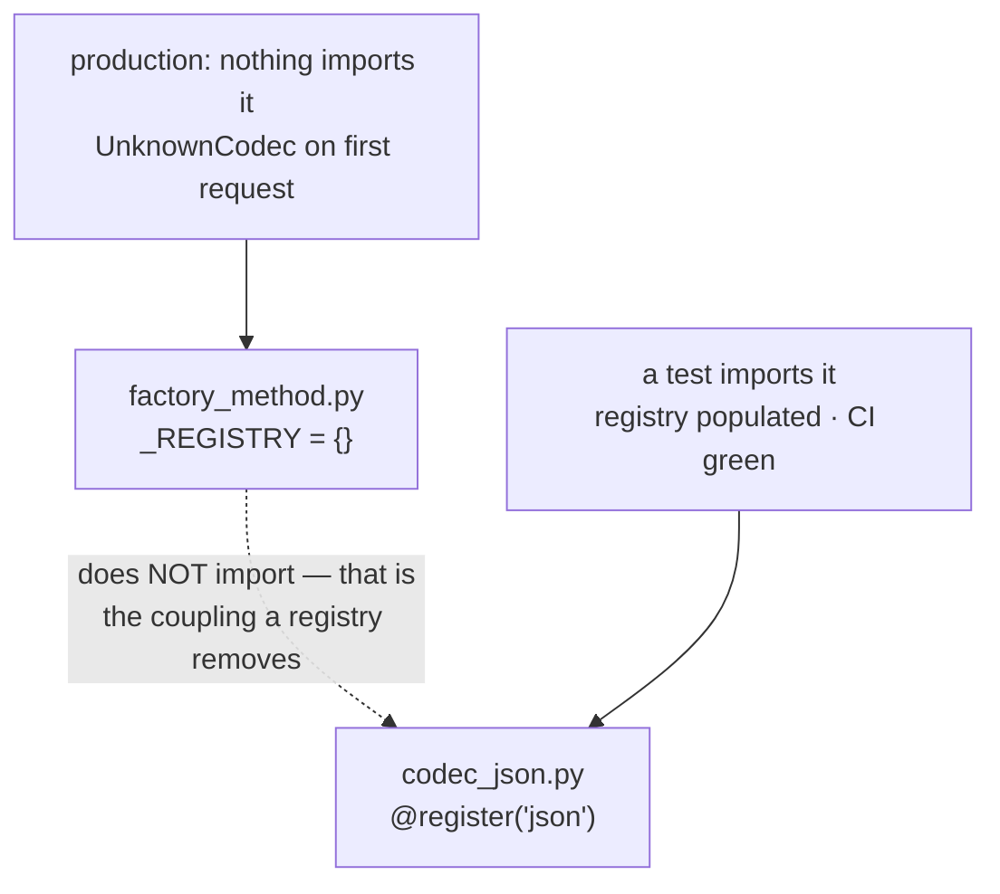

# Factory Method — implementation

The Gang of Four pattern is in here and it is the smallest thing in the file. Most of what this
demonstrates is the gap between it and the three neighbours it gets confused with — and one
production bug that CI structurally cannot see.

```bash
pytest test_factory_method.py -q     # 10 tests
python factory_method.py             # the same assertions, no test runner
```

No `bench.py`. Nothing here is a performance question: a registry lookup versus a constructor call
is a difference nobody will ever measure in a profile, and inventing a benchmark to match the other
implementation directories would be filler. The expensive thing about this pattern is *when it
fails*, not how fast it runs.

## Four things called "factory", and who decides

```
registry / dict of classes   CONFIGURATION decides, at startup
static factory method        the CALLER decides, at call time
Factory Method (GoF)         the SUBCLASS decides, fixed at construction
passing the class            whoever wired it decides, at construction
```

"Which one do I want?" is really **"who should be allowed to decide, and when?"**

| What this file holds | Which kind | Proved by |
|---|---|---|
| `_REGISTRY` + `register` + `codec` | registry | the headline pair below |
| `Exporter` / `CsvExporter` | **genuine GoF Factory Method** | `test_the_subclass_decides_at_construction_not_at_call_time` |
| `ComposedExporter` | passing the class | `test_the_hierarchy_costs_two_classes_for_what_a_parameter_does` |
| `Playlist.__iter__` | **genuine GoF, and the honest example** | `test_iter_is_the_real_factory_method_one_algorithm_three_products` |

## The bug: a registration that never ran



`codec_json.py` is on disk, correct, and spelled right. `register("json")` is a line of code, and
**lines of code only run when their module is imported.** `factory_method.py` does not import it —
importing every implementation is exactly the coupling a registry exists to remove.

In a test suite something always imports it by accident: a fixture, a conftest, pytest's own
collection. In a service, nothing does.

```python
with pytest.raises(UnknownCodec):
    codec("json")

importlib.import_module("codec_json")     # ← the entire difference

assert codec("json").name == "json"
```

### The test that was nearly worthless

The pair above runs behind an `unregistered` fixture that clears `_REGISTRY` and pops the plugin out
of `sys.modules`, reconstructing the state a fresh process starts in. That reconstruction is also
what made the test meaningless: **add `import codec_json` to the top of `factory_method.py` and
every fixture-based test still passes**, because the fixture wipes the registry the import just
populated. The test proved "an empty registry raises on lookup", which is close to a tautology.

Verified by doing exactly that, which is why
`test_a_fresh_process_importing_only_the_factory_has_an_empty_registry` exists and why it runs **out
of process**:

```python
out = subprocess.run(
    [sys.executable, "-c", "import factory_method as f; print(sorted(f._REGISTRY))"],
    cwd=HERE, capture_output=True, text=True, check=True)
assert out.stdout.strip() == "[]"
```

A real interpreter cannot be fooled by a fixture. Whatever `import factory_method` pulls in is what
a production process gets.

### The same bug in a second costume

`python factory_method.py` failed the first time it ran, and the reason is worth meeting here rather
than in a service. Run as a script the module is named `__main__`, so the plugin's
`from factory_method import register` imports a **second copy** of the module with its own empty
`_REGISTRY` — the decorator writes into one and `codec()` reads the other.

Same class of failure: *the registry you are reading is not the registry that was written.* The usual
sighting is a package imported once as `pkg.mod` and once as `mod`, which quietly gives you two of
every class and two of every registry.

## The fix nobody writes: validate at startup

A factory that takes a string is a **trust boundary** — the string came from a config file or an
HTTP header. Three lines at boot turn the worst failure shape into the cheapest one.

```python
def validate_configured(names):
    missing = [n for n in names if n not in _REGISTRY]
    if missing:
        raise UnknownCodec(f"configured but not registered: {missing}; known: {sorted(_REGISTRY)}")
```

Two tests, identical configuration, one flag:

| | `validate=False` | `validate=True` |
|---|---|---|
| `start()` | succeeds | **raises, naming `csv`** |
| first request (`json`) | succeeds | never happens |
| second request (`csv`) | **raises** | never happens |
| `requests_served` when it broke | **2** | **0** |

Without it there is no failure at deploy, none in the smoke test, and none on any endpoint anybody
checked — so the deploy is declared good and the process is hours old before a user finds the one
code path that needed the missing codec. The error also names what *is* registered, which is the
difference between debugging a typo in thirty seconds and thirty minutes.

## The pattern itself, and what the hierarchy costs

```python
assert CsvExporter().export(ROWS) == ComposedExporter(CsvFormatter).export(ROWS)

assert len(Exporter.__subclasses__()) == 2        # one class per product, forever
assert ComposedExporter.__subclasses__() == []    # the parameter needed none
```

Identical output. The two subclasses exist only to answer *"which class do I instantiate"*, and that
question takes a parameter. **In Python a class is a value** — `CsvFormatter` is already a callable
meaning "make me one of these", so wrapping it in a class that returns it is a layer with no
content.

Java is not stuck with the hierarchy either, since 8:

```java
class Exporter {
    private final Supplier<Formatter> make;
    Exporter(Supplier<Formatter> make) { this.make = make; }
}
new Exporter(CsvFormatter::new);
```

**Factory Method is largely a workaround for languages where classes are not values.**

## `__iter__` is the real one

```python
assert Playlist(TITLES).preview()         == ["delta", "alpha", "charlie"]
assert SortedPlaylist(TITLES).preview()   == ["alpha", "charlie", "delta"]
assert ReversedPlaylist(TITLES).preview() == ["charlie", "alpha", "delta"]

for cls in (SortedPlaylist, ReversedPlaylist):
    assert cls.preview is Playlist.preview     # written once, inherited, never reimplemented
```

Creator: the playlist. Product: the iterator. The base class's algorithm consumes a product it
cannot name, and each subclass supplies its own. No registry, no string key, no switch — and it is
in every collection library ever written. Point at this in an interview, not at a
`create_thing(kind)` function.

`preview` is order-sensitive on purpose. An algorithm whose result could not distinguish the three
iterators would demonstrate nothing.

## What this deliberately does NOT implement

- **An import-cycle demo.** `core → factory → concrete → core` is real and common, and showing it
  needs a deliberately broken package for a one-paragraph lesson. The usual "fix" — moving the
  import inside the function — does not remove the cycle, it relocates the failure from startup to
  runtime, where it is worse.
- **Entry points / `ServiceLoader`.** The decoupled answer to the registration bug, and it trades
  one failure for another: registration now lives in packaging metadata, so a missing
  `pip install -e .` silently empties the registry.
- **Abstract Factory.** A different pattern — a *family* of products chosen by composition, against
  one product chosen by inheritance. It belongs in its own entry.
- **A thread-safe registry.** Registration happens at import, which Python already serialises. A
  registry mutated at runtime would need a lock, and would be a different design.

## Related

- **[Factory Method — the pattern page](../../13-design-patterns/factory-method/)** — the full
  treatment: the four factories, Python and Java, seven real examples, interview follow-ups
- [Pattern catalogue](../../13-design-patterns/CATALOGUE.md#factory-method) — where this sits among
  the creational patterns
- [Singleton](../singleton/) — the other creational pattern with a scope problem nobody mentions
- [Circuit breaker](../circuit-breaker/) — what a factory's return value needs once "which
  implementation" becomes "which instance, and is it healthy"
- [Glossary: idempotency](../../GLOSSARY.md#idempotency)
