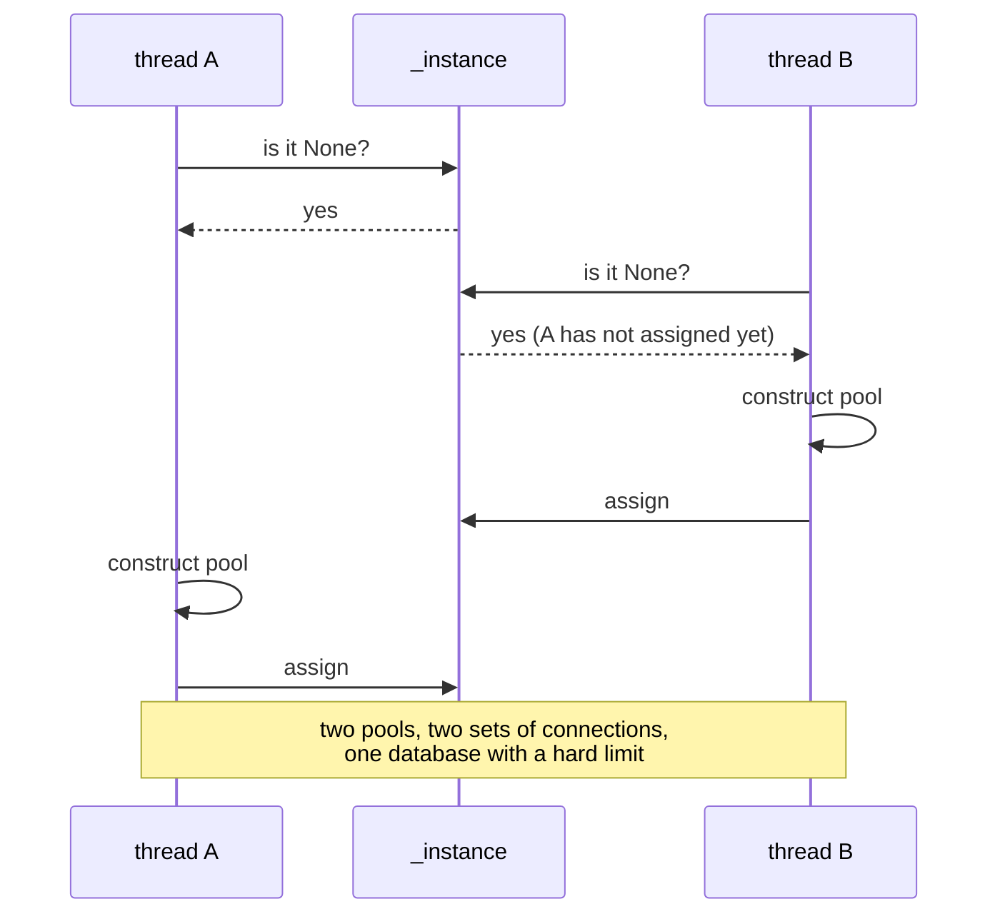
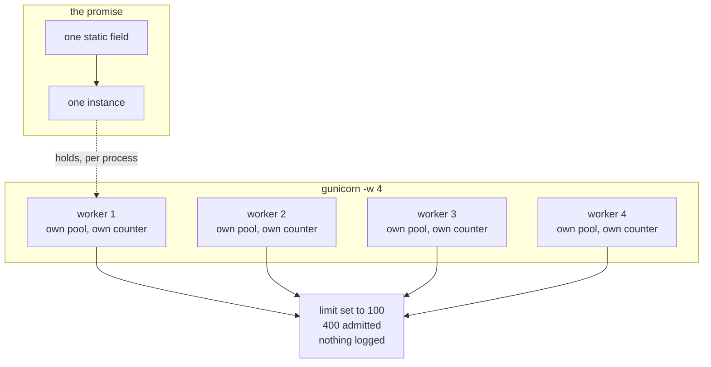

# Singleton — implementation

Every tutorial on this pattern teaches how to make the **creation** thread-safe and then stops. That
is the least interesting of its four problems and the only one a language feature already solves for
you. This file demonstrates all four, and the two that cost real money are the ones nobody mentions.

```bash
pytest test_singleton.py -q     # 8 tests, no sleeps, nothing flaky
python singleton.py             # the same assertions with no test runner
python bench.py                 # 4 real processes, 4 singletons
```

## The four problems, and which tests pin them

| # | Problem | Proved by |
|---|---|---|
| 1 | Creation races — the famous one | `test_the_naive_singleton_builds_one_instance_per_thread` |
| 2 | **Safe to create ≠ safe to use** | `test_a_correctly_created_singleton_still_loses_writes` |
| 3 | **"One" means one per *process*** | `bench.py`, four real processes |
| 4 | Hostile to testing | the `_clean_globals` fixture, which only has to exist at all |

Problems 2 and 3 are the expensive ones. Neither announces itself: nothing raises, nothing logs, the
numbers are just wrong.

## 1. The creation race

The check and the assignment are two steps, and a thread can be interrupted between them:



The GIL does not save you. It guarantees one thread runs bytecode at a time; it does not make a
multi-bytecode *sequence* atomic — and a constructor worth caching is slow by definition, which is
exactly when the switch lands inside it.

**Tested without a single sleep.** A race test that sleeps can only report *"the race did not show up
this time"*, which is indistinguishable from *"there is no race"*. So `Gate` holds every thread
**inside** the constructor while the test counts them, and `wait_for(8)` turns *"eight threads were
in there simultaneously"* into an assertion. The locked version's `no_more()` is the other half, and
it is the one that matters: it proves the other seven threads arrived and were **held out**, rather
than merely not having turned up yet.

Same eight threads, same gate, same constructor: **8 instances against 1.**

## 2. Safe to create is not safe to use

This is the gap, and it is why the pattern is dangerous rather than merely unfashionable.

`Metrics.instance()` is double-checked, locked and correct. There is exactly one instance and the
test asserts it. Then eight threads share that one object's mutable state and the counter ends at
**1 out of 8**.

```python
def bump(self, gate=_noop):
    current = self.hits      # READ
    gate()                   # ← anything at all: a call, a log line, an await
    self.hits = current + 1  # WRITE, from a value that may now be stale
```

`self.hits += 1` is the same bug written shorter. The lock protected the object's **birth** and
nothing about its **life** — and the object then lives for the whole process, touched by every
request thread at once. `bump_safe` differs by one `with` and a *second, separate* lock: `_lock`
decides who gets to build it, `_use_lock` decides what happens afterwards. Confusing those two is how
a textbook-correct singleton still corrupts a counter.

### What this test got wrong first

The first version of `test_the_second_lock_is_what_makes_mutation_safe` ran 400 increments through
`bump_safe` with a `time.sleep(0)` gate and asserted the total. It passed. It also passed with the
lock deleted — a lost update needs the interpreter to switch threads inside a four-bytecode window,
and at the default 5ms switch interval it usually declines to. The test was worth nothing and said so
confidently.

The fix was to stop asserting the symptom and assert the property: the gate now reports whether
`_use_lock` is held at the moment between the read and the write. `bump_safe` says `True`, `bump`
says `False`. Deterministic, and it fails the instant the `with` is removed — verified by removing it.

## 3. "One instance" means one per process



`bench.py` starts four real processes — what `gunicorn -w 4`, `uwsgi --processes 4`, PHP-FPM, a Node
cluster and four Kubernetes replicas all do — and prints what each ended up with:

```
       pid            id(POOL)         id(Metrics)   its counter
      7788       2579416326432       2579411284192           100
     27320       2224903725344       2224898879712           100
     29940       1998769463584       1998764421344           100
     33280       2269633683744       2269628838112           100

  4 distinct processes, 4 distinct POOL objects.
  Read as a rate limiter set to 100: it admitted 400 requests, 4x its own limit.
```

Every process believes its counter is *the* counter. None of them is wrong about its own process, and
the system is still off by 4x. **The in-process guarantee held perfectly; it was the wrong
guarantee.** The same shape halves a cache's hit rate, halves a metrics dashboard, and makes a
Snowflake ID generator issue duplicate primary keys.

Uniqueness across processes is a different pattern entirely: a lease with a
[fencing token](../../13-design-patterns/CATALOGUE.md#distributed-systems-patterns), or
[leader election](../../13-design-patterns/CATALOGUE.md#distributed-systems-patterns). Not a static
field.

### Why `mp.Pool` could not show this

`mp.Pool(4).map(worker, range(4))` hands each task to whichever worker is free first, so a pool of
four happily ran all four tasks **in one process**. The first version of this benchmark printed a
confident table of four identical pids and a sentence claiming four distinct ones. Explicit
`Process` objects are the only way to be sure there really are four.

## 4. Hostile to testing — and this directory is the evidence

Every class here carries a `_reset()` classmethod. Nothing in production wants it. It exists because
class attributes outlive the test that created them, so without it the second test in the file
inherits the first one's object, passes for the wrong reason, and then fails when the file runs in a
different order. **"Passes alone, fails in a suite" is that fixture missing.**

Then compare the last test in the file:

```python
real = ReportService(POOL)
fake = ReportService(ConnectionPool("fake://localhost", size=99))
```

Two services, two different pools, one process, no interference, **no reset**. That is the whole
argument for injection, and the uniqueness guarantee is untouched — production still builds exactly
one pool and passes it in. What changed is that reaching it stopped being a global lookup.

## Measured

```
  double-checked instance()        123.4 ns/op
  always-locking instance()        276.5 ns/op
  a module-level global             18.7 ns/op
```

Two conclusions, and they answer different questions:

- **If you are writing the class, keep the outer check.** It saves 55% of the warm call — the
  uncontended lock really is about half the cost of getting the instance.
- **If you are choosing what to write, do not write the class.** A module-level global is **7x
  cheaper than even the double-checked version**, needs no lock, and has no incorrect version to
  accidentally write. Python's import system already guarantees a module body runs exactly once,
  under a lock.

### What this benchmark got wrong first

It compared `instance()` against a bare `with lock: pass` loop and concluded the outer check saved
nothing. That compares a method call against no method call — the check was never in the comparison.
It needed `AlwaysLocks`, the same class with the one line removed, which is why that class exists.
The number was wrong by ~150ns and the conclusion was wrong outright.

## What this deliberately does NOT implement

- **A metaclass or decorator singleton.** Both exist, both work, neither teaches anything the
  `_instance`/`_lock` pair does not — and both hide the mechanism being explained.
- **Reflection and serialization defences.** They are a real concern and a *Java* one: `readObject`
  and `setAccessible(true)` can both forge a second instance, which is why `enum` is the
  recommended form there. Python has no equivalent attack worth defending against.
- **A distributed singleton.** It is not a singleton; it is leader election, and it belongs with
  consensus rather than here.
- **`functools.cache` on a factory.** Tempting and wrong: it does not guarantee single invocation
  under contention, so it solves the caching half and not the uniqueness half.

## Related

- **[Singleton — the pattern page](../../13-design-patterns/singleton/)** — the full treatment: what
  the terminology means, seven real singletons, the DI alternative, and the interview follow-ups
- [Pattern catalogue](../../13-design-patterns/CATALOGUE.md#singleton) — where this sits among the
  other creational patterns
- [Rate limiting](../rate-limiter/) — the limiter that problem 3 breaks, and what it takes to make it
  correct across processes
- [LRU cache](../lru-cache/) — the other component usually held in a singleton, and what per-process
  duplication does to its hit rate
- [Monolith vs microservices](../../02-architecture/monolith-vs-microservices/) — where the process
  boundary stops being an implementation detail
- [Glossary: consensus](../../GLOSSARY.md#consensus) · [idempotency](../../GLOSSARY.md#idempotency)
