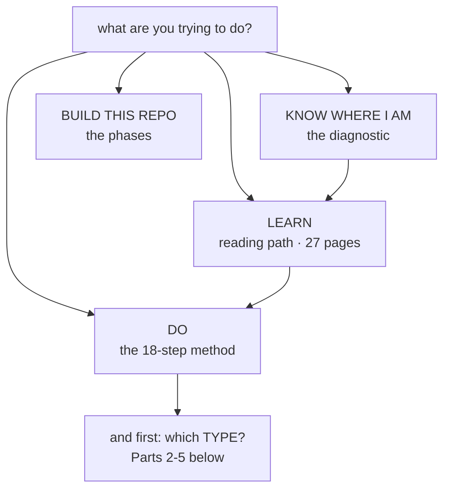
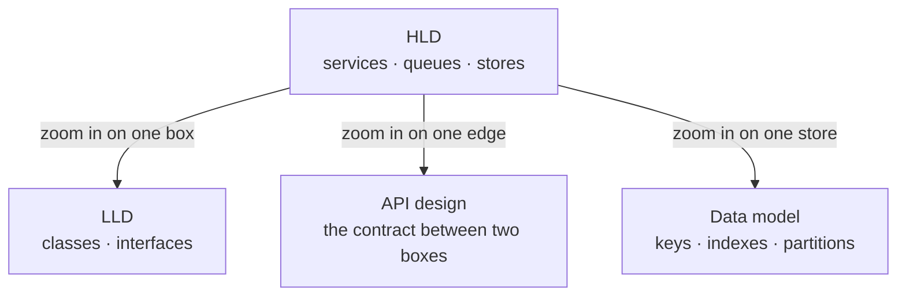
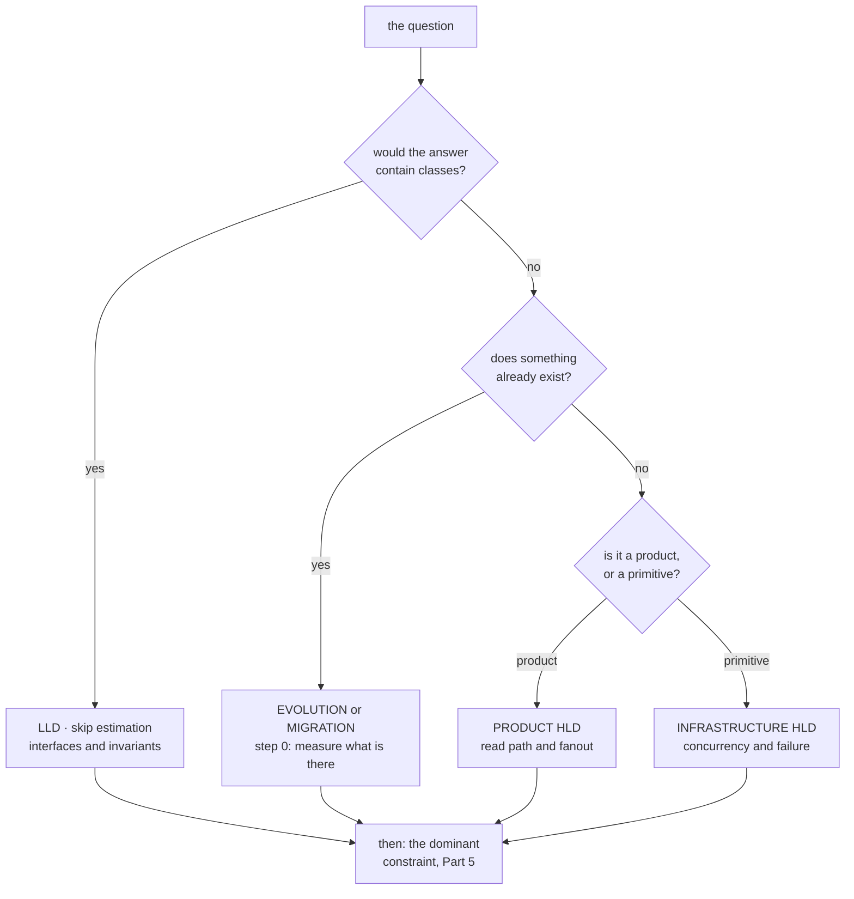

# Types of System Design

Two questions this repository answered everywhere except in one place:

**"In what order?"** — there are four orders here and they answer different questions. Part 1 is the
index nobody had written.

**"What types are there?"** — nothing covered this at all, and it is the more useful half. "Design
Twitter" and "design a parking lot" are both called system design and share almost no method. The
most common interview failure is not weak knowledge, it is **answering the wrong kind of question**:
bringing QPS estimates to a class-diagram problem, or class diagrams to a capacity problem.

Four axes, and a design sits at one point on each.

| Axis | The question | Part |
|---|---|---|
| **Altitude** | What am I drawing — services, or classes? | [2](#part-2--altitude) |
| **Domain** | What kind of system is it? | [3](#part-3--domain) |
| **Starting point** | Does something already exist? | [4](#part-4--starting-point) |
| **Dominant constraint** | What actually picks the architecture? | [5](#part-5--the-dominant-constraint) |

Then [Part 6](#part-6--the-method-is-not-uniform) — the 18-step method does not apply evenly, and
which steps you skip is determined by where you landed on these four.

---

## Part 1 · Which order do you actually want

Four orders exist in this repository. They are not alternatives; they answer different questions,
and the reason "what order should I do this in?" has felt unanswered is that nothing said which one
you were asking for.

| If you want to… | The order is | Where it lives |
|---|---|---|
| **Learn** system design from scratch | A reading path, 27 pages, each with a prev/next footer | [README · Where to start](README.md#where-to-start) |
| **Do** a design, right now, on a real problem | The 18-step method, in four phases | [System Design Thinking · Part 2](SYSTEM-DESIGN-THINKING.md) |
| **Find out where you are** before choosing either | 17 questions that route you by what you get *wrong* | [DIAGNOSTIC.md](DIAGNOSTIC.md) |
| **Build or extend this repository** | Phase 0 → Phase 9 | [ROADMAP.md](ROADMAP.md) |

> **`ROADMAP.md` is the one that misleads**, and it is the reason this page exists. It is a *build*
> roadmap for the repository — Spine, Visualizer, Foundations, Components — and a reader who opens
> it looking for a study plan finds a plan for writing the material rather than for reading it.

**The missing step is the last one.** Both the reading path and the method assume you already know
which kind of design you are doing. That assumption is the rest of this page.

---

## Part 2 · Altitude

What is the unit of your answer? This is the distinction most often fumbled, and it is the easiest
to get right once named.

| Type | Unit of design | Deliverable | Typical question |
|---|---|---|---|
| **HLD** — high-level | Services, datastores, queues, caches | Box-and-arrow diagram **plus capacity numbers** | "Design Twitter's feed" |
| **LLD** — low-level | Classes, interfaces, methods, state machines | Class diagram, method signatures, state transitions | "Design a parking lot", "design an elevator" |
| **API design** | Endpoints, payloads, status codes, versions | A contract someone else can build against | "Design the API for a payment gateway" |
| **Data model design** | Tables, keys, indexes, partitions | A schema with its access patterns | "Design the schema for a chat app" |

**The tell is the unit.** If your answer contains classes, it is LLD. If it contains QPS, it is HLD.
If you produce one when asked for the other, no amount of correctness rescues it — and both
mistakes are common, in both directions.

The three lower boxes are each **one box or one edge** of the HLD, examined closely. That is the
whole relationship, and it explains why "design a parking lot" has no QPS: there is no HLD above it
to put a load on.

| | HLD | LLD |
|---|---|---|
| Estimation | **Central.** Steps 6–7 of the method decide everything downstream | Mostly irrelevant |
| Failure modes | Network partitions, partial failure, retries | Invalid state transitions, concurrency within one process |
| "Scale" means | More machines | More *cases* — a new vehicle type, a new payment method |
| Gets it wrong by | Skipping non-functional requirements | Designing a database instead of an object model |
| Template | [_templates/hld.md](_templates/hld.md) | [_templates/lld.md](_templates/lld.md) |

> **Where this repository sits:** almost everything here is HLD. The
> [Gang of Four pattern pages](13-design-patterns/) — [Singleton](13-design-patterns/singleton/),
> [Factory Method](13-design-patterns/factory-method/) and the rest — are the LLD material, which is
> exactly why they are kept in a system design repository when most material drops them.

---

## Part 3 · Domain

What *kind* of system. This matters because **the hard part is in a different place in each one**,
and the right-hand column is the content — not the list.

| Domain | Examples | Where the difficulty actually is |
|---|---|---|
| **Product / feature** | Feed, chat, booking, notifications | **The read path and fanout.** Writes are rare and reads are enormous, so the design is mostly caching, denormalisation, and deciding fanout-on-write against fanout-on-read |
| **Infrastructure** | Rate limiter, key-value store, scheduler, message queue, load balancer | **Correctness under concurrency and failure.** Nobody is impressed that it works; they want to know what it does when a node dies mid-operation. Exactly-once, fencing, and idempotency live here |
| **Data / analytics** | Pipelines, warehouse, stream processing | **Throughput and backfill.** The live path is the easy half; reprocessing three years of history without taking production down is the design |
| **ML systems** | Training, serving, feature store | **Training/serving skew.** Two code paths computing what is supposed to be the same feature, drifting apart silently, degrading a model nobody is watching |

Mapping onto what is here:

- Product → [real-world problems](15-real-world-problems/url-shortener/), [case studies](17-case-studies/)
- Infrastructure → [implementations](18-implementations/) — a [rate limiter](18-implementations/rate-limiter/),
  an [LRU cache](18-implementations/lru-cache/), a [circuit breaker](18-implementations/circuit-breaker/),
  [consistent hashing](18-implementations/consistent-hashing/) — all written and tested rather than described
- Data → [batch vs stream](09-scalability/batch-vs-stream/)
- ML → **not covered here.** Named in [GAPS.md](GAPS.md) rather than faked

**Why this axis is worth knowing:** an infrastructure question answered with a product answer sounds
plausible and misses the point entirely. "Design a rate limiter" answered with caching layers and
CDN placement has not engaged with the only hard question, which is what happens when two nodes
both think a request is within budget.

---

## Part 4 · Starting point

| Type | What you are given | What changes |
|---|---|---|
| **Greenfield** | A blank page | The interview default. **Rare in real work** |
| **Evolution** | A working V1 that is breaking | The real-work default. The constraint set is already known, and so are the things you cannot change |
| **Migration** | A working system that must become a different working system, without downtime | Strangler fig, expand-contract, dual writes. Correctness during the *transition* is the whole design |
| **Incident-driven** | Something broke at 03:00 | The requirements are a postmortem. The hardest part is resisting a redesign when a parameter change would do |

> Interviews teach greenfield and work is almost entirely the other three. This repository's
> [URL shortener V1→V8](15-real-world-problems/url-shortener/) is deliberately *evolution* rather
> than greenfield for that reason: each version exists because the previous one broke in a specific,
> named way.

**Migration deserves its own note**, because it is the one with a failure mode the others do not
have: there is a window where both systems are live and a request can be served by either. Every
decision in that window is about **consistency between two systems that disagree**, and none of the
greenfield method addresses it. See [schema migration](05-databases/schema-migration/) and the
deployment patterns in the [catalogue](13-design-patterns/CATALOGUE.md#deployment-patterns).

---

## Part 5 · The dominant constraint

The axis that actually picks the architecture. Everything above tells you what kind of answer to
produce; this tells you what the answer *is*.

| Dominant constraint | What it forces | Where it is covered |
|---|---|---|
| **Read-heavy** | Caching, read replicas, denormalisation, fanout-on-write, CDN | [caching](04-caching/fundamentals/) · [replication](05-databases/replication/) · [CDN](10-storage/cdn/) |
| **Write-heavy** | Sharding, LSM storage, batching, queues, fanout-on-read | [sharding](05-databases/sharding/) · [queues](06-messaging/queues/) |
| **Latency-critical** | Edge placement, precomputation, removing synchronous hops | [latency](00-foundations/latency/) · [CDN](10-storage/cdn/) |
| **Consistency-critical** | Single writer, consensus, quorums — and **giving up caching** | [consistency](00-foundations/consistency/) · [CAP](00-foundations/cap-theorem/) |
| **Durability-critical** | Replication factor, write-ahead logs, restore *drills* rather than backups | [reliability](00-foundations/reliability/) |
| **Cost-critical** | Storage tiering, batch instead of stream, fewer moving parts | [cost](09-scalability/cost/) |
| **Availability-critical** | Redundancy, graceful degradation, bulkheads, load shedding | [availability](00-foundations/availability/) · [reliability patterns](08-reliability/) |

**Two of these are in direct opposition and the pair comes up constantly:** consistency-critical
says do not cache, read-heavy says cache everything. A design that claims both has not been
finished. [The trade-off framework](TRADEOFF-FRAMEWORK.md) is how to resolve it, and
[CAP](00-foundations/cap-theorem/) is why there is no third option.

> **Naming the dominant constraint out loud is the single highest-value sentence in a design
> review.** It converts an argument about preferences into an argument about requirements, and the
> second one is resolvable.

---

## Part 6 · The method is not uniform

[The 18-step method](SYSTEM-DESIGN-THINKING.md) is written for HLD-greenfield-product, which is the
interview default and roughly a quarter of real cases. The steps you skip are determined by Parts
2–5.

| Type | What changes about the method |
|---|---|
| **LLD** | Steps 1–5 as written, then **skip estimation entirely** and go to interfaces, state transitions and invariants. QPS is not a property of a parking lot |
| **API design** | Steps 1–5, then **versioning and error semantics replace capacity planning**. The deliverable is a contract, and its hard part is what happens on the second version |
| **Infrastructure** | Estimation matters *more*, and **step 14 (failure modes) is most of the answer** rather than a section near the end |
| **Evolution** | Insert a **step 0: what does the system actually do today, measured** — not what the docs say. Then the method applies to the delta only |
| **Migration** | Step 0 as above, plus the whole design is the **transition window**, which the 18 steps do not model at all |
| **Incident-driven** | Steps 1–7 are already answered by the postmortem. Start at step 8, and bias hard toward the smallest change that works |
| **Data / analytics** | Estimation is about **throughput and backfill volume**, not QPS. "How long to reprocess everything?" is the capacity question |

**The general rule:** the method's order is load-bearing — most bad designs come from doing step 9
before step 3 — but its *completeness* is not. Knowing which steps do not apply is a sign you have
identified the type correctly.

---

## Part 7 · Telling in thirty seconds

Four questions, in this order:

1. **Would the answer contain classes or services?** → altitude (Part 2)
2. **Does something already exist?** → starting point (Part 4)
3. **Is it a product or a primitive other products use?** → domain (Part 3)
4. **Which single constraint dominates?** → the architecture (Part 5)

Say all four out loud before drawing anything. An interviewer hearing *"this is a low-level design
of an infrastructure primitive, greenfield, and the dominant constraint is correctness under
concurrent access"* already knows you will not spend ten minutes on CDN placement.

---

## Worked examples

| Question | Altitude | Domain | Start | Dominant constraint |
|---|---|---|---|---|
| "Design Twitter's feed" | HLD | Product | Greenfield | Read-heavy |
| "Design a parking lot" | **LLD** | Product | Greenfield | *None* — it is about modelling |
| "Design a rate limiter" | HLD **and** LLD | **Infrastructure** | Greenfield | Correctness under concurrency |
| "Our DB is at 90% CPU" | HLD | Product | **Evolution** | Write-heavy |
| "Move from Postgres to DynamoDB, no downtime" | HLD | Product | **Migration** | Consistency *during the window* |
| "Design a payment gateway's API" | **API** | Product | Greenfield | Idempotency and durability |
| "Design a metrics pipeline" | HLD | **Data** | Greenfield | Throughput and backfill |

Row 2 is the one worth staring at. "Design a parking lot" has no dominant constraint on any axis in
Part 5, and that is not an omission — **it is the signal that it is an LLD question**, where the
difficulty is finding the right objects rather than surviving a load.

Row 3 is the other one: a rate limiter is asked at both altitudes in the same interview, and the
two answers share nothing. The HLD answer is about where the counter lives and what happens when
two nodes disagree; the LLD answer is a token bucket's state and its invariants. See
[the implementation](18-implementations/rate-limiter/).

---

## Related

- [System Design Thinking](SYSTEM-DESIGN-THINKING.md) — the 18-step method Part 6 modifies
- [Diagnostic](DIAGNOSTIC.md) — 17 questions that route you by what you get wrong
- [Estimation Guide](ESTIMATION-GUIDE.md) — the step LLD skips and infrastructure leans on
- [Trade-off Framework](TRADEOFF-FRAMEWORK.md) — how to resolve Part 5 when two constraints collide
- [Design checklist](DESIGN-CHECKLIST.md) — what to have covered before calling a design done
- [Templates](_templates/hld.md) · [LLD template](_templates/lld.md) — the two deliverables of Part 2
- [Interview questions](20-system-design-interview/QUESTIONS.md) — 46 questions; classify each one
  on these four axes before answering
- [Design patterns](13-design-patterns/) — the LLD layer, and why it is kept here
- [Coverage gaps](GAPS.md) — including ML systems, named rather than faked
- [Roadmap](ROADMAP.md) — the *build* order for this repository, not a study plan

<!-- PATH:BEGIN -->

---

**The reading path** · step 1 of 28 · *Types of system design*

**Next** [System design thinking](SYSTEM-DESIGN-THINKING.md) ▶

<!-- PATH:END -->
